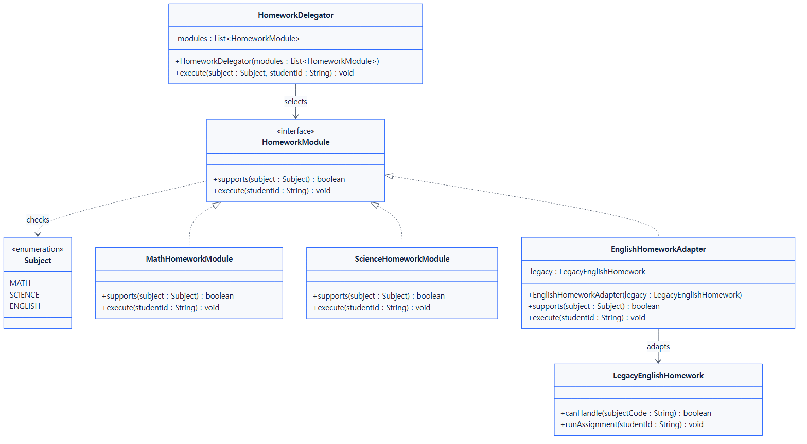
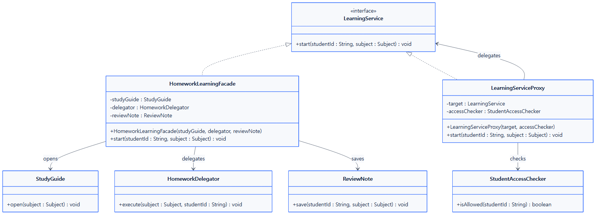
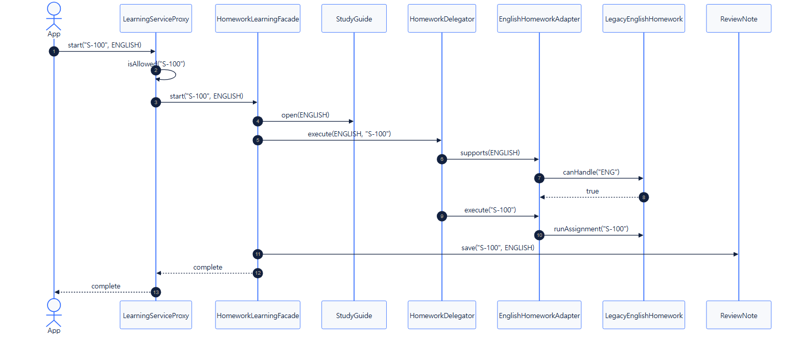

# Ex08 60분 실습 - UML대로 온라인 숙제 실행 시스템 만들기

이 문제는 Java 문법과 인터페이스, 상속, 컬렉션을 사용할 수 있는 학습자를 대상으로 한다. 설계를 처음부터 새로 만드는 문제가 아니다. 먼저 UML을 읽고, 제시된 클래스 이름과 메서드 시그니처를 그대로 코드로 옮긴 뒤 네 가지 구조를 연결한다.

## 학습 목표

- 실제 작업을 알맞은 객체에 맡기는 위임 구조를 구현한다.
- 규격이 다른 레거시 객체를 어댑터로 연결한다.
- 여러 하위 작업을 파사드의 한 메서드로 묶는다.
- 실제 서비스와 같은 인터페이스를 구현하는 프록시에서 접근을 제어한다.
- 요구사항이 바뀌었을 때 어느 객체를 수정해야 하는지 설명한다.

## 업무 상황

온라인 학습실은 수학, 과학, 영어 숙제를 실행한다. 수학과 과학 모듈은 새 시스템의 `HomeworkModule` 규격에 맞게 개발할 수 있다. 영어 숙제는 외부 업체의 기존 모듈을 사용해야 하는데, 이 모듈은 `canHandle(String)`과 `runAssignment(String)`만 제공한다. 외부 모듈의 코드는 수정할 수 없다.

학습 한 번의 순서는 `개념 확인 -> 숙제 실행 -> 오답 노트 저장`으로 고정한다. 클라이언트는 이 세 단계를 직접 호출하지 않고 `LearningService.start()` 하나만 사용한다. 학습을 시작하기 전에는 학생 번호를 확인하며, 허용되지 않은 번호라면 실제 학습 서비스까지 요청이 전달되지 않아야 한다.

이번 실습에서 구현할 네 구조는 서로 다른 문제를 맡는다.

| 구조 | 해결할 문제 |
|---|---|
| 위임 | 선택한 과목의 숙제를 어느 모듈에 실행시킬 것인가 |
| 어댑터 | 메서드와 과목 표현이 다른 영어 모듈을 어떻게 연결할 것인가 |
| 파사드 | 개념 확인, 숙제, 복습 순서를 어떻게 하나의 입구로 제공할 것인가 |
| 프록시 | 실제 학습을 시작하기 전에 학생 번호를 어디에서 확인할 것인가 |

## 1. 최종 UML부터 읽기

이어지는 클래스 UML 두 장과 실행 순서 UML이 이번 실습의 완성 설계다. 첫 번째 클래스 UML은 위임과 어댑터 영역, 두 번째 클래스 UML은 파사드와 프록시 영역을 보여 준다. 화살표만 따라가지 말고 각 객체가 어떤 변경 이유를 맡는지 생각한다.

**UML에서 먼저 확인할 것**

1. `App`은 `LearningService` 타입으로 서비스를 사용한다.
2. `LearningServiceProxy`와 `HomeworkLearningFacade`는 같은 `LearningService` 인터페이스를 구현한다.
3. 프록시는 실제 서비스인 `HomeworkLearningFacade`를 필드로 보관하고 호출을 위임한다.
4. 파사드는 `StudyGuide`, `HomeworkDelegator`, `ReviewNote`를 정해진 순서로 사용한다.
5. `HomeworkDelegator`는 구체 숙제 모듈이 아니라 `HomeworkModule` 목록을 사용한다.

## 2. 위임과 어댑터 상세 UML



`HomeworkDelegator`는 과목을 처리할 수 있는 모듈을 찾는 역할만 맡는다. 실제 숙제 실행은 선택된 `HomeworkModule`에게 맡긴다. 영어 모듈은 새 인터페이스를 구현하지 않으므로 `EnglishHomeworkAdapter` 뒤에 둔다.

| 타입 | 구현 계약 |
|---|---|
| `HomeworkModule` | `supports(subject)`와 `execute(studentId)`를 선언한다. |
| `MathHomeworkModule` | 수학 과목만 지원하고 수학 숙제 메시지를 출력한다. |
| `ScienceHomeworkModule` | 과학 과목만 지원하고 과학 숙제 메시지를 출력한다. |
| `LegacyEnglishHomework` | 제공된 레거시 클래스이며 수정하지 않는다. |
| `EnglishHomeworkAdapter` | 영어 과목을 `ENG` 코드로 바꾸고 레거시 호출로 연결한다. |
| `HomeworkDelegator` | 지원 모듈을 찾아 `execute()`를 호출하고, 없으면 예외를 던진다. |

## 3. 파사드와 프록시 상세 UML



`HomeworkLearningFacade`는 학습 절차를 한곳에서 조정한다. `LearningServiceProxy`는 같은 인터페이스를 구현하면서 실제 서비스 앞에서 학생 번호를 확인한다. 상속으로 기능을 끼워 넣는 것이 아니라, 프록시가 실제 서비스 객체를 보관하고 호출을 넘기는 구조다.

| 타입 | 구현 계약 |
|---|---|
| `LearningService` | 클라이언트가 사용할 `start(studentId, subject)`를 선언한다. |
| `HomeworkLearningFacade` | 개념 확인 -> 숙제 실행 -> 오답 노트 저장 순서를 진행한다. |
| `StudentAccessChecker` | `S-`로 시작하는 학생 번호만 허용한다. |
| `LearningServiceProxy` | 허용된 요청만 실제 서비스의 `start()`로 전달한다. |
| `App` | 객체를 조립한 뒤 `LearningService.start()`만 호출한다. |

## 4. 성공 요청의 실행 순서



성공한 요청은 프록시에서 파사드로 전달된다. 파사드는 세 단계를 실행하고, 숙제 단계에서 위임 객체가 영어 어댑터를 선택한다. 접근이 거부되면 프록시에서 흐름이 끝나므로 파사드와 그 아래 객체는 호출되지 않는다.

## 5. 프로젝트 구성과 제공 코드

파일을 나누는 데 시간을 쓰지 않도록 모든 타입을 `App.java` 하나에 작성한다.

```text
src/
└─ ex08/
   └─ practice/
      └─ App.java
```

- 패키지는 `ex08.practice`를 사용한다.
- `App`만 `public`으로 선언한다.
- 다른 타입은 package-private로 선언한다.
- 외부 라이브러리는 사용하지 않는다.

다음 코드는 문제에서 제공한다. 그대로 `App.java`에 옮기고 수정하지 않는다.

```java
package ex08.practice;

import java.util.List;

enum Subject {
    MATH, SCIENCE, ENGLISH
}

// 외부 업체가 제공한 레거시 모듈이라고 가정한다.
class LegacyEnglishHomework {

    public boolean canHandle(String subjectCode) {
        return "ENG".equals(subjectCode);
    }

    public void runAssignment(String studentId) {
        System.out.println(
                "[숙제-LEGACY] " + studentId + " 영어 숙제 실행"
        );
    }
}

class StudyGuide {

    public void open(Subject subject) {
        System.out.println("[학습] " + subject + " 개념 확인");
    }
}

class ReviewNote {

    public void save(String studentId, Subject subject) {
        System.out.println(
                "[복습] " + studentId + " " + subject + " 오답 노트 저장"
        );
    }
}

class StudentAccessChecker {

    public boolean isAllowed(String studentId) {
        return studentId != null && studentId.startsWith("S-");
    }
}
```

## 6. 1단계 - 공통 규격과 기본 모듈 만들기 (10분)

먼저 수학과 과학 모듈이 따를 공통 규격을 만든다.

```java
interface HomeworkModule {
    boolean supports(Subject subject);
    void execute(String studentId);
}
```

`MathHomeworkModule`과 `ScienceHomeworkModule`을 구현한다.

| 클래스 | `supports()` 규칙 | `execute()` 출력 |
|---|---|---|
| `MathHomeworkModule` | `Subject.MATH`일 때만 `true` | `[숙제] {studentId} 수학 숙제 실행` |
| `ScienceHomeworkModule` | `Subject.SCIENCE`일 때만 `true` | `[숙제] {studentId} 과학 숙제 실행` |

**1단계 확인**

- 두 클래스가 모두 `HomeworkModule`을 구현하는가?
- 한 모듈이 다른 과목까지 지원한다고 응답하지 않는가?
- 출력문 이외의 과목 선택 로직이 `execute()` 안에 들어가지 않았는가?

## 7. 2단계 - 숙제 실행을 위임하기 (10분)

`HomeworkDelegator`는 생성자로 `List<HomeworkModule>`을 받아 필드에 보관한다.

```java
class HomeworkDelegator {
    private final List<HomeworkModule> modules;

    public HomeworkDelegator(List<HomeworkModule> modules) {
        this.modules = modules;
    }

    public void execute(Subject subject, String studentId) {
        // TODO 1: subject를 지원하는 첫 번째 모듈을 찾는다.
        // TODO 2: 찾은 모듈의 execute(studentId)를 호출한다.
        // TODO 3: 없으면 IllegalArgumentException을 던진다.
    }
}
```

지원 모듈이 없을 때의 예외 메시지는 다음과 같이 맞춘다.

```text
지원하지 않는 과목: {subject}
```

`HomeworkDelegator.execute()`에는 `if (subject == Subject.MATH)` 같은 과목별 분기를 작성하지 않는다. 모듈 선택에는 각 객체의 `supports()`를 사용한다.

**2단계 확인**

- 위임 객체가 실제 수학·과학 숙제 내용을 직접 출력하지 않는가?
- 모듈을 고른 뒤에는 같은 `execute()`를 호출하는가?
- 모듈이 없을 때 조용히 종료하지 않고 명확한 예외를 던지는가?

## 8. 3단계 - 레거시 영어 모듈을 어댑터로 연결하기 (10분)

`LegacyEnglishHomework`는 `HomeworkModule`을 구현하지 않는다. 레거시 클래스를 수정하지 말고 다음 구조의 어댑터를 만든다.

```java
class EnglishHomeworkAdapter implements HomeworkModule {
    private final LegacyEnglishHomework legacy;

    public EnglishHomeworkAdapter(LegacyEnglishHomework legacy) {
        this.legacy = legacy;
    }

    @Override
    public boolean supports(Subject subject) {
        // TODO: ENGLISH를 레거시 코드 ENG로 바꾸어 확인한다.
        return false;
    }

    @Override
    public void execute(String studentId) {
        // TODO: 레거시 runAssignment()로 호출을 바꾼다.
    }
}
```

`supports()`는 `subject == Subject.ENGLISH`이고 `legacy.canHandle("ENG")`도 참일 때만 `true`를 반환한다. `execute()`는 `legacy.runAssignment(studentId)`를 호출한다.

**3단계 확인**

- `HomeworkDelegator`는 `LegacyEnglishHomework`의 존재를 모르는가?
- 문자열 코드 `ENG`는 어댑터 밖으로 새어 나오지 않는가?
- 레거시 객체의 메서드 이름과 매개변수를 수정하지 않았는가?

## 9. 4단계 - 학습 절차를 파사드로 묶기 (10분)

클라이언트가 사용할 인터페이스를 먼저 만든다.

```java
interface LearningService {
    void start(String studentId, Subject subject);
}
```

`HomeworkLearningFacade`는 `LearningService`를 구현하고 다음 세 객체를 생성자로 받는다.

```java
class HomeworkLearningFacade implements LearningService {
    private final StudyGuide studyGuide;
    private final HomeworkDelegator delegator;
    private final ReviewNote reviewNote;

    // TODO: 생성자

    @Override
    public void start(String studentId, Subject subject) {
        // TODO 1: [학습시작] 메시지
        // TODO 2: 개념 확인
        // TODO 3: 숙제 실행
        // TODO 4: 오답 노트 저장
        // TODO 5: [학습완료] 메시지
    }
}
```

`start()`의 순서와 출력은 다음과 같다.

1. `[학습시작] {subject}` 출력
2. `studyGuide.open(subject)` 호출
3. `delegator.execute(subject, studentId)` 호출
4. `reviewNote.save(studentId, subject)` 호출
5. `[학습완료] {subject}` 출력

**4단계 확인**

- `App`이 개념 확인, 숙제, 복습을 각각 호출하지 않는가?
- 학습 순서를 알고 있는 객체가 파사드 한 곳뿐인가?
- 파사드가 영어 레거시 모듈을 직접 호출하지 않는가?

## 10. 5단계 - 접근 제어 프록시 만들기 (10분)

프록시도 `LearningService`를 구현한다. 실제 서비스와 접근 검사기를 생성자로 받아 필드에 보관한다.

```java
class LearningServiceProxy implements LearningService {
    private final LearningService target;
    private final StudentAccessChecker accessChecker;

    // TODO: 생성자

    @Override
    public void start(String studentId, Subject subject) {
        // TODO 1: 허용되지 않은 번호면 접근 거부를 출력하고 종료한다.
        // TODO 2: 허용된 번호면 확인 완료를 출력한다.
        // TODO 3: target.start(studentId, subject)를 호출한다.
    }
}
```

접근 결과 메시지는 다음과 같이 맞춘다.

```text
[학생확인] S-100 확인 완료
[접근거부] GUEST
```

프록시는 `HomeworkLearningFacade`를 상속하지 않는다. `LearningService` 타입의 실제 객체를 필드로 보관하고, 허용된 요청만 그 객체에 위임한다.

**5단계 확인**

- 프록시와 실제 서비스가 같은 인터페이스를 구현하는가?
- 접근이 거부되면 `target.start()`가 호출되지 않는가?
- 학생 번호 검사 코드가 파사드 안에 들어가지 않았는가?

## 11. 6단계 - 객체를 조립하고 실행하기 (10분)

`App.main()`을 다음과 같이 작성한다. `App`은 실제 파사드가 아니라 `LearningService` 타입의 프록시만 사용한다.

```java
public class App {

    public static void main(String[] args) {
        List<HomeworkModule> modules = List.of(
                new MathHomeworkModule(),
                new ScienceHomeworkModule(),
                new EnglishHomeworkAdapter(
                        new LegacyEnglishHomework()
                )
        );

        HomeworkDelegator delegator =
                new HomeworkDelegator(modules);

        LearningService realService =
                new HomeworkLearningFacade(
                        new StudyGuide(),
                        delegator,
                        new ReviewNote()
                );

        LearningService service =
                new LearningServiceProxy(
                        realService,
                        new StudentAccessChecker()
                );

        service.start("S-100", Subject.ENGLISH);

        System.out.println();

        service.start("GUEST", Subject.MATH);
    }
}
```

첫 번째 요청은 허용된 영어 숙제다. 프록시, 파사드, 위임, 어댑터가 모두 실행되어야 한다. 두 번째 요청은 접근 거부 사례다. `[접근거부] GUEST` 뒤에는 학습 관련 메시지가 한 줄도 출력되지 않아야 한다.

## 12. 예상 실행 결과

```text
[학생확인] S-100 확인 완료
[학습시작] ENGLISH
[학습] ENGLISH 개념 확인
[숙제-LEGACY] S-100 영어 숙제 실행
[복습] S-100 ENGLISH 오답 노트 저장
[학습완료] ENGLISH

[접근거부] GUEST
```

컴파일과 실행 명령은 다음과 같다.

```powershell
javac -encoding UTF-8 -d out src/ex08/practice/App.java
java -Dfile.encoding=UTF-8 -cp out ex08.practice.App
```

## 13. 제출 전 확인

- [ ] UML에 있는 인터페이스와 클래스를 모두 구현했다.
- [ ] `HomeworkDelegator`에 과목별 `if-else`가 없다.
- [ ] 실제 숙제 실행은 선택된 `HomeworkModule`이 담당한다.
- [ ] 레거시 영어 모듈은 수정하지 않고 어댑터로 연결했다.
- [ ] `HomeworkLearningFacade.start()`가 세 단계의 순서를 관리한다.
- [ ] `LearningServiceProxy`는 실제 서비스를 상속하지 않고 필드로 보관한다.
- [ ] 접근 거부 요청은 파사드까지 전달되지 않는다.
- [ ] 실제 출력이 예상 실행 결과와 일치한다.

## 14. 구현 뒤 설명할 질문

1. 영어 모듈을 어댑터 없이 연결하면 어느 객체가 `ENG`와 `runAssignment()`를 알아야 하는가?
2. 국어 숙제 모듈을 추가할 때 `HomeworkDelegator.execute()`를 수정하지 않아도 되는 이유는 무엇인가?
3. 복습 뒤 학습 통계를 저장한다면 어느 객체의 순서를 수정해야 하는가?
4. 학생 번호 확인을 파사드에 넣으면 파사드의 변경 이유가 왜 늘어나는가?
5. 프록시가 실제 서비스를 상속하는 것보다 `LearningService` 필드로 보관하는 편이 교체와 테스트에 유리한 이유는 무엇인가?

## 15. 선택 도전

`Subject.KOREAN`과 `KoreanHomeworkModule`을 추가한다. `HomeworkDelegator`와 `HomeworkLearningFacade`, `LearningServiceProxy`의 기존 메서드는 수정하지 않는다. 열거형, 새 모듈, `App`의 객체 조립 코드만 변경하여 다음 요청을 실행한다.

```java
service.start("S-200", Subject.KOREAN);
```

도전을 마친 뒤 어떤 변경이 위임, 어댑터, 파사드, 프록시와 관련되는지 한 문장씩 설명한다. 모든 요구사항에 패턴을 억지로 붙이지 말고, 실제로 수정된 책임을 기준으로 답한다.
