# 거래명세서 발송 시스템을 단계별로 리팩터링하기

이 책은 빈칸을 채우는 문제지가 아니다. 이미 준비된 `step1/App.java`를 실행한 뒤, 한 번에 한 가지 설계 문제만 해결하면서 `step10`의 완성 구조까지 따라가는 코드 워크스루다.

각 장은 같은 순서로 진행한다.

1. 지금 코드에서 불편한 점을 실행 결과와 변경 요청으로 발견한다.
2. 이번 단계에서 이동할 책임을 정한다.
3. 코드를 작은 순서로 작성한다.
4. 실행 결과로 동작이 보존되었는지 확인한다.
5. 다음 단계로 넘어가기 전에 설계 의도를 한 문장으로 정리한다.

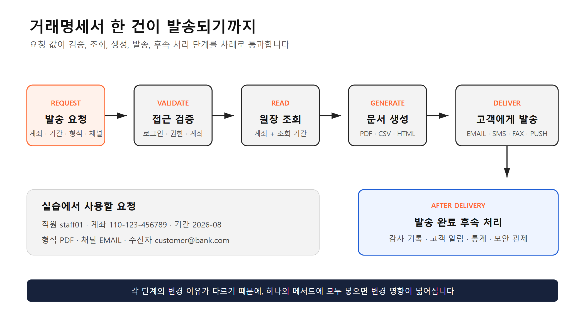

완성된 코드를 처음부터 읽는 것보다, 코드가 왜 지금 모양이 되었는지를 변화 순서대로 읽는 것이 중요하다. 이 책의 목표는 패턴 이름을 많이 기억하는 것이 아니라, 변경 이유를 발견하고 적절한 객체 경계를 만드는 감각을 익히는 것이다.

<!-- pagebreak -->

# 시작하기 - step1이 준비되어 있다

실습 시작 파일은 다음 경로에 있다.

```text
src/ex15/step1/App.java
```

각 단계의 완성 코드는 `step2`부터 `step10`까지 체크포인트로 제공된다. 먼저 이 책의 순서대로 직접 작성한 뒤, 막히거나 실행 결과가 다를 때 다음 단계 파일과 비교한다.

| 용도 | 사용하는 코드 |
|---|---|
| 출발점 | `src/ex15/step1/App.java` |
| 단계별 완성본 | `src/ex15/step2/App.java`부터 `step9/App.java` |
| 전체 통합본 | `src/ex15/step10/App.java` |

`step2`부터 `step9`는 한 패턴에 집중하기 위해 관련 코드만 남긴 작은 실험실이다. 앞 단계 전체를 그대로 누적한 파일이 아니다. 각 실험실에서 패턴의 핵심을 확인한 뒤, 마지막 `step10`에서 모든 구조를 다시 조립한다.

## 컴파일과 실행

프로젝트 루트에서 단계 번호만 바꾸어 실행한다.

```powershell
javac -encoding UTF-8 -d out src/ex15/step1/App.java
java -cp out ex15.step1.App
```

다음 단계는 패키지 이름과 경로를 함께 바꾼다.

```powershell
javac -encoding UTF-8 -d out src/ex15/step2/App.java
java -cp out ex15.step2.App
```

이 책에 나오는 출력은 Java 21에서 실제로 컴파일하고 실행해 확인한 결과다.

<!-- pagebreak -->

# 전체 여정 - 한 번에 하나의 변경 이유만 분리한다

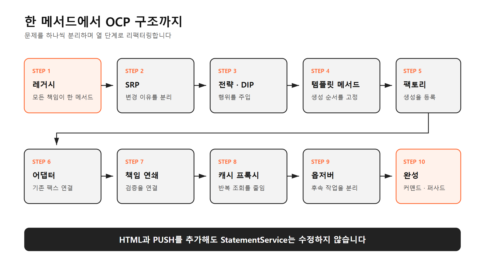

| 단계 | 먼저 발견할 문제 | 이번 단계의 해법 | 끝났을 때 남는 질문 |
|---|---|---|---|
| 1 | 한 메서드가 모든 일을 함 | 현재 동작 고정 | 왜 작은 변경도 위험한가? |
| 2 | 변경 이유가 한 클래스에 모임 | SRP로 책임 추출 | 구현 교체는 왜 여전히 어려운가? |
| 3 | 서비스가 구체 구현을 선택함 | 전략과 생성자 주입 | 생성 순서의 중복은 어디에 둘까? |
| 4 | 형식마다 생성 순서가 반복됨 | 템플릿 메서드 | 전략 선택 분기는 어디로 옮길까? |
| 5 | 타입별 `if`가 서비스에 생김 | 등록형 팩토리 | 규격이 다른 외부 API는 어떻게 연결할까? |
| 6 | 기존 팩스 API의 메서드가 다름 | 어댑터 | 검증 규칙이 늘면 서비스는 어떻게 되는가? |
| 7 | 검증 추가와 순서 변경이 잦음 | 책임 연쇄 | 반복 조회를 어디서 막을까? |
| 8 | 같은 원장 조회가 반복됨 | 캐시 프록시 | 발송 뒤 작업이 늘면 어떻게 분리할까? |
| 9 | 감사, 알림, 통계가 계속 추가됨 | 옵저버 | 요청을 저장하고 나중에 실행하려면? |
| 10 | 조립과 실행 시점 제어가 복잡함 | 커맨드와 퍼사드 | 새 기능을 서비스 수정 없이 추가할 수 있는가? |

각 단계의 성공 기준은 클래스 수가 늘어났는지가 아니다. 핵심 업무 코드에서 서로 다른 변경 이유가 빠져나갔는지를 확인해야 한다.

> 리팩터링의 기본 규칙은 동작을 보존하면서 구조를 바꾸는 것이다. 매 단계에서 먼저 실행하고, 바꾸고, 다시 실행한다.

<!-- pagebreak -->

# STEP 1 - 현재 동작을 먼저 고정한다

소스: `src/ex15/step1/App.java`

`App.main()`은 사용자와 요청을 만들고 `LegacyStatementService`를 호출한다.

```java
User user = new User("staff01", true, true);
StatementRequest request = new StatementRequest(
        "110-123-456789",
        "2026-08",
        "PDF",
        "EMAIL"
);

new LegacyStatementService().명세서를발송한다(user, request);
```

지금은 코드를 고치지 않는다. 먼저 실행해서 정상 경로의 기준 출력을 남긴다.

```text
[요청] 거래명세서 발송을 시작합니다.
[원장] 110-123-456789 / 2026-08 거래내역 조회
[PDF] 머리말 작성
[PDF] 거래내역 작성: 입금 100,000원 / 출금 30,000원
[PDF] 꼬리말 작성
[이메일] staff01에게 발송: PDF 거래명세서
[감사] staff01의 발송 이력을 기록합니다.
```

이 출력이 이후 리팩터링의 안전망이다. 구조를 바꾼 뒤에도 검증, 조회, 생성, 발송, 감사의 업무 순서가 의도대로 유지되어야 한다.

## 코드 흐름에 표시하기

`명세서를발송한다()` 안에서 다음 여섯 덩어리에 주석이나 IDE 북마크를 붙여 본다.

1. 로그인과 권한 검증
2. 거래내역 조회
3. 문서 형식 선택
4. 문서 생성
5. 발송 채널 선택과 발송
6. 감사 기록

한 메서드가 여섯 가지 책임을 가진다는 사실을 먼저 눈으로 확인해야 다음 분리가 기계적인 클래스 쪼개기가 되지 않는다.

<!-- pagebreak -->

# STEP 1 - 실패 경로를 실행해 경계를 찾는다

정상 경로만 실행하면 `return`이 어디에서 흐름을 끊는지 보이지 않는다. 입력값을 한 번씩 바꾸어 실패 경로도 확인한다.

## 로그인 실패

```java
User user = new User("staff01", false, true);
```

```text
[요청] 거래명세서 발송을 시작합니다.
[중단] 로그인이 필요합니다.
```

## 지원하지 않는 문서 형식

```java
StatementRequest request = new StatementRequest(
        "110-123-456789", "2026-08", "HTML", "EMAIL"
);
```

```text
[요청] 거래명세서 발송을 시작합니다.
[원장] 110-123-456789 / 2026-08 거래내역 조회
[중단] 지원하지 않는 문서 형식입니다.
```

문서 형식을 검증하기 전에 원장을 이미 조회한다. 현재 코드의 동작이지만, 요구사항에 따라 불필요한 원장 호출이 될 수 있다. 리팩터링 중에는 이런 실행 순서도 의식적으로 결정해야 한다.

## 팩스 발송

`channel`을 `FAX`로 바꾸면 서비스가 직접 `LegacyFaxClient`를 생성한다.

```java
LegacyFaxClient faxClient = new LegacyFaxClient();
faxClient.transmit("051-000-0000", document);
```

팩스 API의 이름과 매개변수 순서가 핵심 서비스 안으로 새어 들어왔다. 이 결합은 STEP 6에서 제거한다.

<!-- pagebreak -->

# STEP 1 - 변경 요청으로 코드 냄새를 확인한다

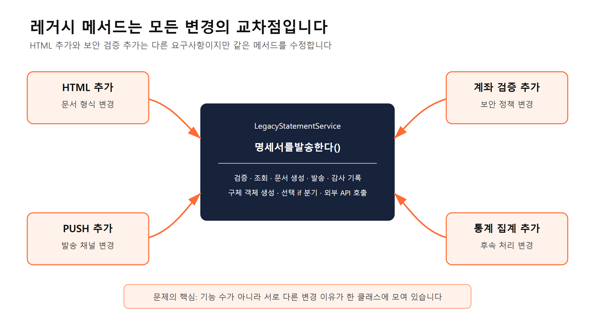

다음 네 가지 요구사항이 들어왔다고 가정한다.

| 새 요구사항 | 지금 수정할 위치 | 함께 다시 확인할 코드 |
|---|---|---|
| HTML 문서 추가 | 문서 형식 `if` | 검증, 조회, 발송, 감사 |
| PUSH 발송 추가 | 발송 채널 `if` | 검증, 조회, 생성, 감사 |
| 계좌 접근 검사 추가 | 메서드 앞부분 | 모든 정상 경로와 실패 경로 |
| 발송 통계 추가 | 메서드 마지막 | 발송 성공 여부와 감사 순서 |

`LegacyStatementService`는 문서 정책, 채널 정책, 보안 정책, 감사 정책 때문에 모두 수정된다. 서로 다른 변경 이유가 한 클래스에 모여 있으므로 작은 기능 추가도 관련 없는 회귀 테스트를 만든다.

여기서 바로 패턴을 고르지 않는다. 먼저 책임을 분리해 중심 흐름을 보이게 만든다.

## STEP 1 완료 문장

> 레거시 서비스는 일을 많이 해서 문제가 아니라, 서로 다른 이유로 계속 수정되어야 해서 위험하다.

다음 단계의 목표는 실행 결과를 유지하면서 책임을 클래스 단위로 옮기는 것이다.

<!-- pagebreak -->

# STEP 2 - 검증 책임을 AccessChecker로 옮긴다

소스: `src/ex15/step2/App.java`

첫 번째 이동 대상은 메서드 앞의 검증 코드다. `AccessChecker`를 만들고 로그인과 권한 검사를 그대로 옮긴다.

```java
class AccessChecker {
    boolean 통과한다(User user) {
        if (!user.login) {
            System.out.println("[중단] 로그인이 필요합니다.");
            return false;
        }

        if (!user.statementManager) {
            System.out.println("[중단] 거래명세서 발송 권한이 없습니다.");
            return false;
        }

        return true;
    }
}
```

서비스에는 검증의 세부 조건 대신 검증 결과만 남긴다.

```java
if (!accessChecker.통과한다(user)) {
    return;
}
```

이 이동에서 중요한 것은 조건문을 짧게 만드는 일이 아니다. 접근 정책이 바뀔 때 열어야 할 클래스를 `AccessChecker`로 한정하는 것이다.

## 바로 실행해 볼 실패 경로

`login`을 `false`로 바꾸면 원장 조회가 출력되지 않아야 한다.

```text
[중단] 로그인이 필요합니다.
```

검증 실패 뒤에 조회와 발송이 이어진다면 추출 과정에서 `return` 경계를 잃은 것이다.

<!-- pagebreak -->

# STEP 2 - 조회, 생성, 발송, 감사를 차례로 추출한다

이제 남은 네 책임을 각각 이름 있는 클래스로 옮긴다.

```java
class TransactionReader {
    String 거래내역조회(String accountNo, String period) {
        System.out.println("[원장] " + accountNo + " / " + period + " 거래내역 조회");
        return "입금 100,000원 / 출금 30,000원";
    }
}

class PdfStatementGenerator {
    String 생성한다(String transactions) {
        System.out.println("[PDF] 거래명세서 생성: " + transactions);
        return "PDF 거래명세서";
    }
}

class EmailStatementSender {
    void 발송한다(String receiver, String document) {
        System.out.println("[이메일] " + receiver + "에게 발송: " + document);
    }
}

class AuditLogger {
    void 기록한다(String userId) {
        System.out.println("[감사] " + userId + "의 발송 이력을 기록합니다.");
    }
}
```

추출할 때는 원래 메서드의 데이터 흐름을 그대로 따른다.

```text
User, StatementRequest
    -> 검증
    -> accountNo, period로 transactions 조회
    -> transactions로 document 생성
    -> receiver와 document로 발송
    -> userId로 감사 기록
```

메서드 이름과 매개변수가 곧 객체의 계약이다. 클래스 이름만 나눈 뒤 필드에 원래 데이터를 모두 넘기면 책임 경계가 다시 흐려진다.

<!-- pagebreak -->

# STEP 2 - 서비스에는 업무 순서만 남긴다

추출한 객체를 필드에 두고 서비스 메서드를 다시 작성한다.

```java
class StatementService {
    private final AccessChecker accessChecker = new AccessChecker();
    private final TransactionReader transactionReader = new TransactionReader();
    private final PdfStatementGenerator generator = new PdfStatementGenerator();
    private final EmailStatementSender sender = new EmailStatementSender();
    private final AuditLogger auditLogger = new AuditLogger();

    void 명세서를발송한다(User user, StatementRequest request) {
        if (!accessChecker.통과한다(user)) {
            return;
        }

        String transactions = transactionReader.거래내역조회(
                request.accountNo,
                request.period
        );
        String document = generator.생성한다(transactions);
        sender.발송한다(user.id, document);
        auditLogger.기록한다(user.id);
    }
}
```

실행 결과는 다음과 같다.

```text
[원장] 110-123-456789 / 2026-08 거래내역 조회
[PDF] 거래명세서 생성: 입금 100,000원 / 출금 30,000원
[이메일] staff01에게 발송: PDF 거래명세서
[감사] staff01의 발송 이력을 기록합니다.
```

## 좋아진 점

- 각 클래스가 한 가지 변경 이유를 가진다.
- 서비스 메서드에서 업무 순서를 읽을 수 있다.
- PDF 생성이나 감사 출력 변경이 서로 분리된다.

## 아직 남은 결합

```java
private final PdfStatementGenerator generator = new PdfStatementGenerator();
private final EmailStatementSender sender = new EmailStatementSender();
```

서비스가 구체 클래스를 직접 생성한다. CSV나 SMS로 교체하려면 `StatementService`를 다시 수정해야 한다.

## STEP 2 완료 문장

> SRP는 변경 이유를 분리했지만, 구체 구현을 선택하는 책임까지 자동으로 없애 주지는 않는다.

<!-- pagebreak -->

# STEP 3 - 바뀌는 두 행위를 인터페이스로 만든다

소스: `src/ex15/step3/App.java`

문서 생성 방식과 발송 방식은 실행할 때 교체될 수 있다. 두 행위를 각각 인터페이스로 정의한다.

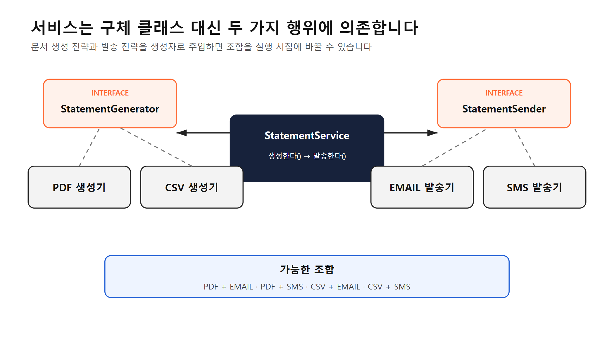

```java
interface StatementGenerator {
    String 생성한다(String transactions);
}

interface StatementSender {
    void 발송한다(String receiver, String document);
}
```

기존 PDF와 이메일 코드는 이 계약을 구현한다.

```java
class PdfStatementGenerator implements StatementGenerator {
    @Override
    public String 생성한다(String transactions) {
        System.out.println("[PDF] 거래명세서 생성: " + transactions);
        return "PDF 거래명세서";
    }
}

class EmailStatementSender implements StatementSender {
    @Override
    public void 발송한다(String receiver, String document) {
        System.out.println("[이메일] " + receiver + "에게 발송: " + document);
    }
}
```

인터페이스를 만드는 것만으로는 결합이 사라지지 않는다. 서비스 필드의 타입과 생성 방식까지 함께 바꿔야 한다.

<!-- pagebreak -->

# STEP 3 - 생성자 주입으로 선택권을 바깥으로 옮긴다

서비스는 더 이상 구현체를 직접 `new` 하지 않는다. 필요한 행위를 생성자로 받는다.

```java
class StatementService {
    private final StatementGenerator generator;
    private final StatementSender sender;

    StatementService(
            StatementGenerator generator,
            StatementSender sender
    ) {
        this.generator = generator;
        this.sender = sender;
    }

    void 명세서를발송한다(String receiver, String transactions) {
        String document = generator.생성한다(transactions);
        sender.발송한다(receiver, document);
    }
}
```

생성자 주입 뒤에는 조립하는 쪽이 조합을 선택한다.

```java
StatementService emailPdfService = new StatementService(
        new PdfStatementGenerator(),
        new EmailStatementSender()
);

StatementService smsCsvService = new StatementService(
        new CsvStatementGenerator(),
        new SmsStatementSender()
);
```

실행 결과에서 같은 서비스가 두 조합을 처리하는지 확인한다.

```text
[PDF] 거래명세서 생성: 입금 100,000원 / 출금 30,000원
[이메일] customer@bank.com에게 발송: PDF 거래명세서

[CSV] 거래명세서 생성: 입금 100,000원 / 출금 30,000원
[문자] 010-0000-0000에게 다운로드 링크 발송: CSV 거래명세서
```

전략은 바뀌는 행위를 객체로 만든다. DIP는 서비스가 구체 클래스가 아니라 그 행위의 추상화에 의존하게 한다.

## STEP 3 완료 문장

> 서비스는 문서를 어떻게 만들고 어떻게 보낼지 결정하지 않고, 주입받은 전략을 순서대로 실행한다.

<!-- pagebreak -->

# STEP 3 - 교체 가능성을 테스트로 생각한다

생성자 주입의 효과는 운영 구현 교체뿐 아니라 테스트에서도 드러난다. 실제 이메일 대신 기억만 하는 가짜 발송기를 넣을 수 있다.

```java
class FakeStatementSender implements StatementSender {
    String receivedDocument;

    @Override
    public void 발송한다(String receiver, String document) {
        receivedDocument = document;
    }
}
```

```java
FakeStatementSender fakeSender = new FakeStatementSender();
StatementService service = new StatementService(
        new PdfStatementGenerator(),
        fakeSender
);

service.명세서를발송한다(
        "customer@bank.com",
        "입금 100,000원"
);

System.out.println(fakeSender.receivedDocument);
```

```text
PDF 거래명세서
```

테스트가 쉬워진 이유는 테스트 도구를 추가했기 때문이 아니다. 서비스가 구체 이메일 클래스의 생성과 생명주기를 더 이상 소유하지 않기 때문이다.

## 다음 단계로 가기 전 점검

- `StatementService` 필드 타입이 인터페이스인가?
- 생성자 안에서 구체 구현을 다시 `new` 하지 않았는가?
- `CSV + SMS`를 만들 때 서비스 코드는 바뀌지 않는가?
- 새 전략이 기존 전략의 내부 상태를 공유하지 않는가?

문서 형식이 늘면 생성기마다 공통 순서가 반복된다. 다음 단계에서는 교체 가능한 객체 안의 중복된 알고리즘 순서를 정리한다.

<!-- pagebreak -->

# STEP 4 - 공통 생성 순서를 먼저 적는다

소스: `src/ex15/step4/App.java`

PDF와 CSV는 표현은 다르지만 생성 순서는 같다.

```text
준비 -> 머리말 -> 거래내역 -> 꼬리말 -> 완성 문서 반환
```

이 순서를 하위 클래스마다 복사하면 한 형식이 검증이나 저장 단계를 빼먹을 수 있다. 상위 클래스가 전체 순서를 소유하도록 `StatementGenerator`를 추상 클래스로 바꾼다.

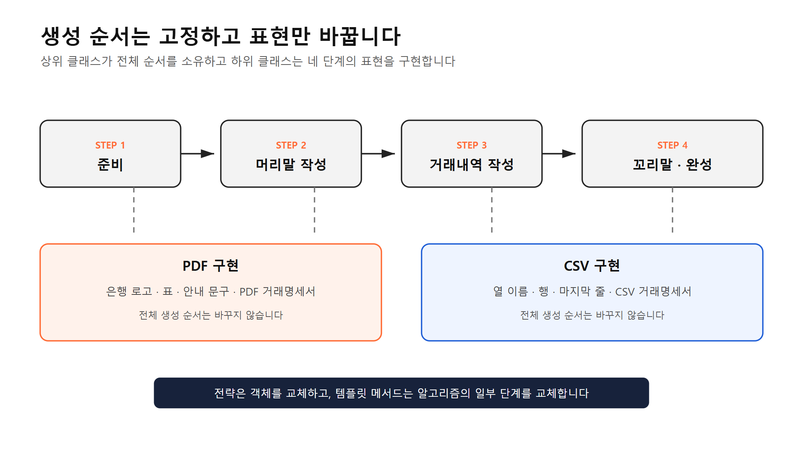

```java
abstract class StatementGenerator {

    public final String 생성한다(String transactions) {
        준비한다();
        머리말을작성한다();
        거래내역을작성한다(transactions);
        꼬리말을작성한다();
        return 완성된문서();
    }

    private void 준비한다() {
        System.out.println("[공통] 거래명세서 생성을 준비합니다.");
    }

    protected abstract void 머리말을작성한다();
    protected abstract void 거래내역을작성한다(String transactions);
    protected abstract void 꼬리말을작성한다();
    protected abstract String 완성된문서();
}
```

`생성한다()`는 템플릿 메서드다. `final`은 하위 클래스가 순서를 바꾸지 못하게 하고, `protected abstract` 메서드는 형식별 차이를 구현할 자리를 제공한다.

<!-- pagebreak -->

# STEP 4 - PDF와 CSV는 다른 부분만 구현한다

PDF 생성기는 표와 안내 문구를 작성한다.

```java
class PdfStatementGenerator extends StatementGenerator {
    @Override
    protected void 머리말을작성한다() {
        System.out.println("[PDF] 은행 로고와 제목을 작성합니다.");
    }

    @Override
    protected void 거래내역을작성한다(String transactions) {
        System.out.println("[PDF] 표로 작성: " + transactions);
    }

    @Override
    protected void 꼬리말을작성한다() {
        System.out.println("[PDF] 안내 문구를 작성합니다.");
    }

    @Override
    protected String 완성된문서() {
        return "PDF 거래명세서";
    }
}
```

CSV 생성기는 같은 네 단계에서 다른 표현을 만든다.

```java
class CsvStatementGenerator extends StatementGenerator {
    @Override
    protected void 머리말을작성한다() {
        System.out.println("[CSV] 열 이름을 작성합니다.");
    }

    @Override
    protected void 거래내역을작성한다(String transactions) {
        System.out.println("[CSV] 행으로 작성: " + transactions);
    }

    @Override
    protected void 꼬리말을작성한다() {
        System.out.println("[CSV] 마지막 줄을 확인합니다.");
    }

    @Override
    protected String 완성된문서() {
        return "CSV 거래명세서";
    }
}
```

하위 클래스에 `생성한다()`를 다시 만들고 있다면 전체 순서를 상위 클래스에 모으지 못한 것이다.

<!-- pagebreak -->

# STEP 4 - 출력으로 템플릿을 확인한다

```text
[공통] 거래명세서 생성을 준비합니다.
[PDF] 은행 로고와 제목을 작성합니다.
[PDF] 표로 작성: 입금 100,000원 / 출금 30,000원
[PDF] 안내 문구를 작성합니다.
완성: PDF 거래명세서

[공통] 거래명세서 생성을 준비합니다.
[CSV] 열 이름을 작성합니다.
[CSV] 행으로 작성: 입금 100,000원 / 출금 30,000원
[CSV] 마지막 줄을 확인합니다.
완성: CSV 거래명세서
```

첫 번째 줄과 단계 수는 같고, 중간 표현만 다르다.

| 구분 | 전략 패턴 | 템플릿 메서드 패턴 |
|---|---|---|
| 바꾸는 단위 | 행위 객체 전체 | 알고리즘의 일부 단계 |
| 주요 수단 | 인터페이스와 합성 | 추상 클래스와 상속 |
| 이 예제 | 생성기 또는 발송기 교체 | 문서 생성 순서 고정 |
| 확장 방식 | 다른 객체를 주입 | 다른 하위 클래스를 추가 |

두 패턴은 경쟁 관계가 아니다. 최종 구조에서는 형식에 맞는 생성기 객체를 전략처럼 선택하고, 선택된 생성기 내부는 템플릿 메서드로 공통 순서를 지킨다.

## STEP 4 완료 문장

> 바뀌지 않아야 할 전체 순서는 상위 클래스가 소유하고, 형식마다 달라지는 표현만 하위 클래스가 구현한다.

<!-- pagebreak -->

# STEP 5 - 문자열 대신 타입으로 선택한다

소스: `src/ex15/step5/App.java`

전략을 만들었어도 요청 값을 보고 구현체를 고르는 코드는 필요하다. 먼저 선택 값을 enum으로 제한한다.

```java
enum StatementFormat {
    PDF, CSV
}

enum DeliveryChannel {
    EMAIL, SMS
}
```

문자열 `"PDf"` 같은 오타는 컴파일러가 찾지 못하지만, enum에 없는 값은 코드로 작성할 수 없다. enum은 팩토리의 키이자 요청이 허용하는 값의 목록이 된다.

그다음 문서 생성 방법을 `GeneratorFactory`에 등록한다.

```java
class GeneratorFactory {
    private final Map<StatementFormat, Supplier<StatementGenerator>> creators
            = new HashMap<>();

    void 등록한다(
            StatementFormat format,
            Supplier<StatementGenerator> creator
    ) {
        creators.put(format, creator);
    }

    StatementGenerator 생성한다(StatementFormat format) {
        Supplier<StatementGenerator> creator = creators.get(format);
        if (creator == null) {
            throw new IllegalArgumentException(
                    "지원하지 않는 문서 형식: " + format
            );
        }
        return creator.get();
    }
}
```

`Supplier`를 저장하므로 팩토리는 등록할 때 객체를 하나 만들어 공유하는 대신, 요청할 때 새 객체를 만들 수 있다.

<!-- pagebreak -->

# STEP 5 - 발송 팩토리도 같은 구조로 만든다

발송 방식도 동일한 선택 문제를 가진다.

```java
class SenderFactory {
    private final Map<DeliveryChannel, Supplier<StatementSender>> creators
            = new HashMap<>();

    void 등록한다(
            DeliveryChannel channel,
            Supplier<StatementSender> creator
    ) {
        creators.put(channel, creator);
    }

    StatementSender 생성한다(DeliveryChannel channel) {
        Supplier<StatementSender> creator = creators.get(channel);
        if (creator == null) {
            throw new IllegalArgumentException(
                    "지원하지 않는 발송 채널: " + channel
            );
        }
        return creator.get();
    }
}
```

애플리케이션 시작 지점에서 생성 방법을 등록한다.

```java
GeneratorFactory generatorFactory = new GeneratorFactory();
generatorFactory.등록한다(StatementFormat.PDF, PdfStatementGenerator::new);
generatorFactory.등록한다(StatementFormat.CSV, CsvStatementGenerator::new);

SenderFactory senderFactory = new SenderFactory();
senderFactory.등록한다(DeliveryChannel.EMAIL, EmailStatementSender::new);
senderFactory.등록한다(DeliveryChannel.SMS, SmsStatementSender::new);
```

서비스는 enum을 팩토리에 전달하고 인터페이스 타입의 결과를 받는다.

```java
StatementGenerator generator = generatorFactory.생성한다(format);
StatementSender sender = senderFactory.생성한다(channel);

String document = generator.생성한다(transactions);
sender.발송한다(receiver, document);
```

서비스 안에서 `switch`나 `instanceof`가 다시 생기면 선택 책임이 팩토리 밖으로 새어 나온 것이다.

<!-- pagebreak -->

# STEP 5 - 새 형식을 추가해 확장 지점을 확인한다

새로운 TEXT 형식을 추가한다고 가정한다. 먼저 enum과 구현 클래스를 추가한다.

```java
enum StatementFormat {
    PDF, CSV, TEXT
}

class TextStatementGenerator implements StatementGenerator {
    @Override
    public String 생성한다(String transactions) {
        System.out.println("[TEXT] 거래내역 작성: " + transactions);
        return "TEXT 거래명세서";
    }
}
```

조립 코드에서 생성 방법을 등록한다.

```java
generatorFactory.등록한다(
        StatementFormat.TEXT,
        TextStatementGenerator::new
);
```

OCP는 프로그램의 어느 파일도 절대 수정하지 않는다는 뜻이 아니다. 지원 값과 조립 코드는 바뀔 수 있다. 중요한 기준은 새 형식 때문에 핵심 업무 메서드의 기존 분기를 다시 고치지 않는 것이다.

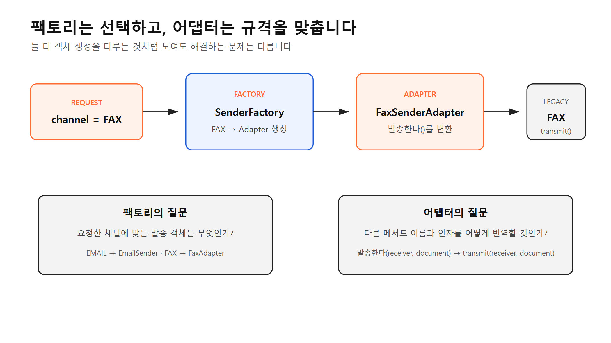

## STEP 5 완료 문장

> 팩토리는 타입별 생성 결정을 한곳에 모으고, 서비스는 선택된 추상화만 사용한다.

다음 단계에서는 팩토리에도 그대로 등록할 수 없는 규격의 기존 팩스 시스템을 연결한다.

<!-- pagebreak -->

# STEP 6 - 바꿀 수 없는 팩스 API를 그대로 둔다

소스: `src/ex15/step6/App.java`

새 시스템의 발송 계약은 `발송한다(receiver, document)`다.

```java
interface StatementSender {
    void 발송한다(String receiver, String document);
}
```

하지만 기존 팩스 모듈은 메서드 이름과 용어가 다르다.

```java
class LegacyFaxClient {
    void transmit(String phoneNumber, String payload) {
        System.out.println(
                "[기존 팩스] " + phoneNumber + "로 전송: " + payload
        );
    }
}
```

기존 클래스를 수정해서 `StatementSender`를 구현하게 만들지 않는다. 외부 라이브러리이거나 다른 시스템에서도 사용하는 클래스라면 수정 권한이 없고, 업그레이드 때 변경이 사라질 수도 있다.

대신 새 계약과 기존 호출 사이에 변환 객체를 둔다.

```java
class FaxStatementSenderAdapter implements StatementSender {
    private final LegacyFaxClient faxClient;

    FaxStatementSenderAdapter(LegacyFaxClient faxClient) {
        this.faxClient = faxClient;
    }

    @Override
    public void 발송한다(String receiver, String document) {
        faxClient.transmit(receiver, document);
    }
}
```

어댑터의 역할은 발송 정책을 새로 만드는 것이 아니라, 새 시스템의 호출을 기존 시스템이 이해하는 호출로 번역하는 것이다.

<!-- pagebreak -->

# STEP 6 - 어댑터도 같은 발송 전략으로 등록한다

어댑터가 `StatementSender`를 구현하므로 팩토리는 이메일과 팩스를 같은 타입으로 다룬다.

```java
LegacyFaxClient legacyFaxClient = new LegacyFaxClient();

SenderFactory senderFactory = new SenderFactory();
senderFactory.등록한다(
        DeliveryChannel.EMAIL,
        EmailStatementSender::new
);
senderFactory.등록한다(
        DeliveryChannel.FAX,
        () -> new FaxStatementSenderAdapter(legacyFaxClient)
);
```

메서드 참조 대신 람다를 사용한 이유는 어댑터 생성자에 기존 팩스 객체를 전달해야 하기 때문이다.

```java
StatementSender sender = senderFactory.생성한다(DeliveryChannel.FAX);
sender.발송한다("051-000-0000", "PDF 거래명세서");
```

```text
[기존 팩스] 051-000-0000로 전송: PDF 거래명세서
```

서비스 입장에서는 이메일과 팩스 모두 `StatementSender`다. `transmit()`이라는 이름은 어댑터 밖으로 나오지 않는다.

## 팩토리와 어댑터를 구분하기

| 객체 | 해결하는 질문 |
|---|---|
| 팩토리 | 요청한 타입에 맞는 객체를 어떻게 얻을까? |
| 어댑터 | 규격이 다른 기존 객체를 새 인터페이스로 어떻게 사용할까? |

## STEP 6 완료 문장

> 외부 API의 차이는 어댑터 안에 가두고, 나머지 시스템은 하나의 발송 계약만 사용한다.

<!-- pagebreak -->

# STEP 7 - 검증을 독립된 객체로 나눈다

소스: `src/ex15/step7/App.java`

검증 규칙은 로그인, 역할, 계좌 접근, 시간 제한처럼 계속 늘 수 있다. 하나의 `AccessChecker`에 모든 조건을 다시 쌓으면 STEP 1의 큰 조건문으로 돌아간다.

각 검증을 한 객체로 만들고 같은 계약을 따르게 한다.

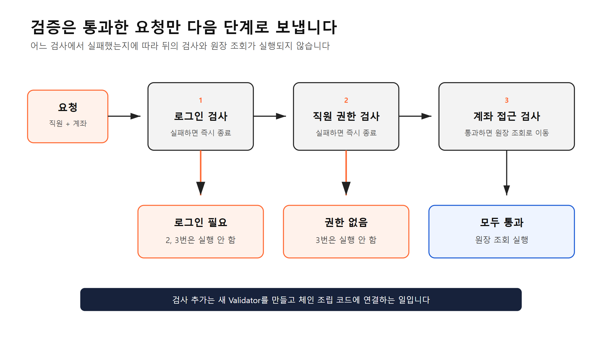

```java
abstract class RequestValidator {
    private RequestValidator next;

    RequestValidator setNext(RequestValidator next) {
        this.next = next;
        return next;
    }

    public final boolean 검증한다(User user, StatementRequest request) {
        if (!현재검증을통과한다(user, request)) {
            return false;
        }

        return next == null || next.검증한다(user, request);
    }

    protected abstract boolean 현재검증을통과한다(
            User user,
            StatementRequest request
    );
}
```

`검증한다()`가 공통 연결 로직을 담당하고, 하위 클래스는 현재 규칙만 판단한다. 현재 검증이 실패하면 다음 객체를 호출하지 않는다.

<!-- pagebreak -->

# STEP 7 - 로그인, 역할, 계좌 검증을 구현한다

로그인 검증기는 로그인 상태만 안다.

```java
class LoginValidator extends RequestValidator {
    @Override
    protected boolean 현재검증을통과한다(
            User user,
            StatementRequest request
    ) {
        if (!user.login) {
            System.out.println("[중단] 로그인이 필요합니다.");
            return false;
        }
        System.out.println("[통과] 로그인 확인");
        return true;
    }
}
```

역할과 계좌 검증기도 같은 방법으로 한 규칙만 구현한다.

```java
class AccountValidator extends RequestValidator {
    @Override
    protected boolean 현재검증을통과한다(
            User user,
            StatementRequest request
    ) {
        if (!user.allowedAccountNo.equals(request.accountNo)) {
            System.out.println("[중단] 이 계좌에 접근할 수 없습니다.");
            return false;
        }
        System.out.println("[통과] 계좌 접근 권한 확인");
        return true;
    }
}
```

체인은 애플리케이션 시작 지점에서 순서대로 연결한다.

```java
RequestValidator validationChain = new LoginValidator();
validationChain
        .setNext(new RoleValidator())
        .setNext(new AccountValidator());
```

`setNext()`가 전달받은 다음 객체를 반환하므로 연속 호출이 가능하다.

<!-- pagebreak -->

# STEP 7 - 실패 지점에서 멈추는지 확인한다

허용되지 않은 계좌를 전달한다.

```java
StatementRequest deniedRequest = new StatementRequest("999-999-999999");
System.out.println(
        "검증 결과: " + validationChain.검증한다(user, deniedRequest)
);
```

```text
[통과] 로그인 확인
[통과] 직원 권한 확인
[중단] 이 계좌에 접근할 수 없습니다.
검증 결과: false
```

허용된 계좌는 끝까지 통과한다.

```text
[통과] 로그인 확인
[통과] 직원 권한 확인
[통과] 계좌 접근 권한 확인
검증 결과: true
```

실패한 검증 뒤의 객체가 호출되지 않는 것이 책임 연쇄의 핵심이다. 검증 순서도 정책이다. 비용이 낮고 빠르게 실패할 수 있는 검증을 앞에 두는 것이 일반적이다.

## 새 검증을 추가하는 방법

야간 발송을 막으려면 `NightTimeValidator` 하나를 만들고 체인 조립 코드에 연결한다. 기존 검증기와 서비스 메서드는 수정하지 않는다.

## STEP 7 완료 문장

> 각 검증기는 자신의 규칙만 판단하고, 성공한 경우에만 다음 검증으로 책임을 넘긴다.

<!-- pagebreak -->

# STEP 8 - 원장 조회 계약부터 만든다

소스: `src/ex15/step8/App.java`

같은 계좌와 기간을 반복 조회하면 비싼 원장 시스템 호출이 반복된다. 서비스에 캐시 코드를 넣기 전에 실제 조회 객체와 캐시 객체가 함께 따를 계약을 만든다.

```java
interface TransactionSource {
    String 거래내역조회(String accountNo, String period);
}
```

실제 원장 조회 객체가 이 계약을 구현한다.

```java
class CoreBankingTransactionSource implements TransactionSource {
    @Override
    public String 거래내역조회(String accountNo, String period) {
        System.out.println(
                "[원장 시스템] " + accountNo + " / " + period
                        + " 거래내역 조회"
        );
        return "입금 100,000원 / 출금 30,000원";
    }
}
```

서비스는 앞으로 `CoreBankingTransactionSource`의 구체 타입이 아니라 `TransactionSource`만 사용한다. 이 동일한 계약이 있어야 대리 객체를 앞에 끼워도 클라이언트 코드를 바꾸지 않을 수 있다.

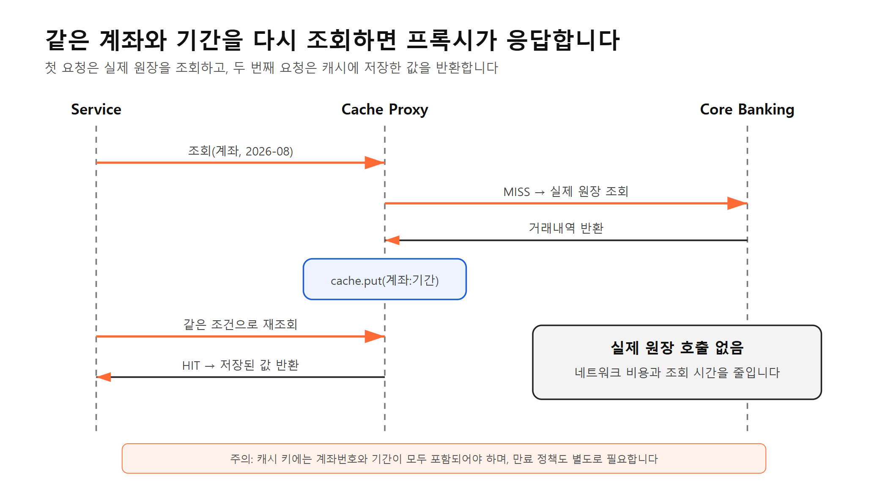

<!-- pagebreak -->

# STEP 8 - 프록시가 캐시와 실제 객체를 선택한다

프록시는 실제 객체를 필드에 보관하고 같은 인터페이스를 구현한다.

```java
class CachedTransactionSourceProxy implements TransactionSource {
    private final TransactionSource target;
    private final Map<String, String> cache = new HashMap<>();

    CachedTransactionSourceProxy(TransactionSource target) {
        this.target = target;
    }

    @Override
    public String 거래내역조회(String accountNo, String period) {
        String key = accountNo + ":" + period;

        if (cache.containsKey(key)) {
            System.out.println("[캐시 HIT] 저장된 거래내역을 반환합니다.");
            return cache.get(key);
        }

        System.out.println("[캐시 MISS] 실제 원장 시스템을 조회합니다.");
        String transactions = target.거래내역조회(accountNo, period);
        cache.put(key, transactions);
        return transactions;
    }
}
```

조립할 때 실제 객체를 프록시로 감싼다.

```java
TransactionSource realSource = new CoreBankingTransactionSource();
TransactionSource source = new CachedTransactionSourceProxy(realSource);
```

클라이언트 변수의 타입은 계속 `TransactionSource`다. 실제 객체인지 프록시인지 알 필요가 없다.

<!-- pagebreak -->

# STEP 8 - MISS와 HIT를 순서대로 확인한다

같은 인자로 두 번 호출한다.

```java
source.거래내역조회("110-123-456789", "2026-08");
source.거래내역조회("110-123-456789", "2026-08");
```

```text
[캐시 MISS] 실제 원장 시스템을 조회합니다.
[원장 시스템] 110-123-456789 / 2026-08 거래내역 조회

[캐시 HIT] 저장된 거래내역을 반환합니다.
```

두 번째 호출에서 `[원장 시스템]` 출력이 다시 나타나지 않아야 한다.

## 실제 시스템에서 추가로 결정할 것

- 거래가 추가되었을 때 캐시를 언제 무효화할 것인가?
- 조회 기간이 긴 요청과 짧은 요청의 키가 충돌하지 않는가?
- 사용자 권한이 다른데 같은 캐시 값을 공유해도 되는가?
- 여러 스레드가 동시에 같은 키를 조회해도 안전한가?
- 실패 응답이나 빈 결과도 캐시할 것인가?

이 예제는 패턴 구조를 보여 주기 위해 단순한 `HashMap`을 사용한다. 운영 캐시는 일관성, 만료, 용량 제한을 별도로 설계해야 한다.

## STEP 8 완료 문장

> 프록시는 실제 객체와 같은 계약을 지키면서, 호출 전후에 캐시 같은 접근 정책을 추가한다.

<!-- pagebreak -->

# STEP 9 - 발송 완료 사실을 이벤트로 만든다

소스: `src/ex15/step9/App.java`

감사 기록, 고객 알림, 통계는 모두 발송이 성공한 뒤 실행된다. 서비스가 이 객체들을 하나씩 직접 호출하면 후속 작업이 늘 때마다 서비스가 수정된다.

먼저 후속 작업이 받을 데이터를 이벤트 객체로 묶는다.

```java
class StatementSentEvent {
    String userId;
    String receiver;
    String document;

    StatementSentEvent(String userId, String receiver, String document) {
        this.userId = userId;
        this.receiver = receiver;
        this.document = document;
    }
}
```

모든 후속 작업이 따를 옵저버 계약을 만든다.

```java
interface StatementSentObserver {
    void 발송완료(StatementSentEvent event);
}
```

이벤트는 단순한 문자열 알림보다 의미가 분명하다. 필요한 데이터가 늘어도 메서드 매개변수 목록을 모든 옵저버에서 동시에 바꾸지 않아도 된다.

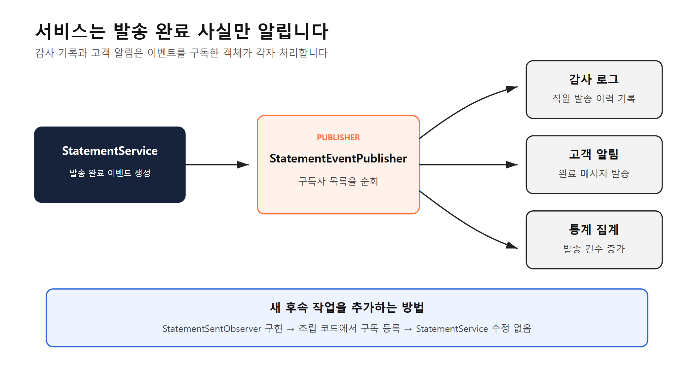

<!-- pagebreak -->

# STEP 9 - 후속 작업을 옵저버로 분리한다

각 옵저버는 발송 완료에 반응하는 한 가지 일만 수행한다.

```java
class AuditLogObserver implements StatementSentObserver {
    @Override
    public void 발송완료(StatementSentEvent event) {
        System.out.println(
                "[감사] " + event.userId + "의 발송 이력을 기록합니다."
        );
    }
}

class CustomerNotificationObserver implements StatementSentObserver {
    @Override
    public void 발송완료(StatementSentEvent event) {
        System.out.println(
                "[알림] " + event.receiver + "에게 발송 완료를 안내합니다."
        );
    }
}

class DeliveryStatisticsObserver implements StatementSentObserver {
    @Override
    public void 발송완료(StatementSentEvent event) {
        System.out.println("[통계] 거래명세서 발송 건수를 1 증가시킵니다.");
    }
}
```

감사와 통계가 같은 이벤트를 받더라도 서로의 구체 클래스를 모른다. 새 보안 관제 작업은 새 옵저버로 추가할 수 있다.

<!-- pagebreak -->

# STEP 9 - 발행자가 구독자 목록을 관리한다

발행자는 옵저버를 등록하고 이벤트를 순서대로 전달한다.

```java
class StatementEventPublisher {
    private final List<StatementSentObserver> observers = new ArrayList<>();

    void 구독한다(StatementSentObserver observer) {
        observers.add(observer);
    }

    void 발행한다(StatementSentEvent event) {
        for (StatementSentObserver observer : observers) {
            observer.발송완료(event);
        }
    }
}
```

조립 코드에서 후속 작업을 등록한다.

```java
StatementEventPublisher publisher = new StatementEventPublisher();
publisher.구독한다(new AuditLogObserver());
publisher.구독한다(new CustomerNotificationObserver());
publisher.구독한다(new DeliveryStatisticsObserver());
```

서비스는 발송 성공 뒤 이벤트 한 번만 발행한다.

```java
publisher.발행한다(
        new StatementSentEvent(userId, receiver, document)
);
```

```text
[발송] customer@bank.com에게 발송: PDF 거래명세서
[감사] staff01의 발송 이력을 기록합니다.
[알림] customer@bank.com에게 발송 완료를 안내합니다.
[통계] 거래명세서 발송 건수를 1 증가시킵니다.
```

## 실패 정책은 별도로 정해야 한다

현재 구현은 첫 옵저버에서 예외가 나면 뒤 옵저버가 실행되지 않는다. 운영 환경에서는 옵저버별 예외 처리, 재시도 큐, 트랜잭션 경계 중 무엇을 택할지 결정해야 한다.

## STEP 9 완료 문장

> 서비스는 발송 완료 사실만 알리고, 그 사실에 반응할 후속 작업은 구독자가 결정한다.

<!-- pagebreak -->

# STEP 10 - 지금까지 만든 부품을 한 시스템으로 조립한다

소스: `src/ex15/step10/App.java`

`step10`은 STEP 2부터 STEP 9까지의 실험 결과를 하나의 실행 흐름으로 합친다. 코드를 위에서 아래로 읽기보다 다음 다섯 층으로 나누어 읽는다.

| 층 | 주요 타입 | 맡은 책임 |
|---|---|---|
| 입력 데이터 | `User`, `StatementRequest` | 요청 상태 보관 |
| 정책과 확장점 | 검증기, 생성기, 발송기, 옵저버 | 바뀌는 규칙 구현 |
| 선택과 대리 | 팩토리, 어댑터, 프록시 | 구현 선택과 연결 |
| 핵심 유스케이스 | `StatementService` | 업무 순서 조정 |
| 실행 제어 | 커맨드, 큐, 퍼사드 | 예약과 실행 시점 분리 |

최종 요청은 문자열 대신 enum과 수신자를 가진다.

```java
class StatementRequest {
    String accountNo;
    String period;
    StatementFormat format;
    DeliveryChannel channel;
    String receiver;
}
```

사용자에는 계좌 접근 검증을 위한 `allowedAccountNo`가 추가된다.

```java
User user = new User(
        "staff01",
        true,
        true,
        "110-123-456789"
);
```

이 데이터는 검증, 조회, 생성기 선택, 발송기 선택을 한 요청 안에서 이어 준다.

<!-- pagebreak -->

# STEP 10 - 검증 체인과 캐시 프록시를 조립한다

첫 번째 조립은 요청을 실행하기 전에 적용할 검증 정책이다.

```java
RequestValidator validationChain = new LoginValidator();
validationChain
        .setNext(new RoleValidator())
        .setNext(new AccountValidator());
```

두 번째 조립은 원장 조회 앞에 캐시 정책을 두는 일이다.

```java
TransactionSource transactionSource = new CachedTransactionSourceProxy(
        new CoreBankingTransactionSource()
);
```

두 변수 모두 추상 타입으로 선언한다.

```text
RequestValidator
TransactionSource
```

이 조립 위치가 애플리케이션의 구성 루트다. 어떤 검증을 어떤 순서로 사용할지, 실제 조회를 어떤 프록시로 감쌀지를 업무 메서드 밖에서 결정한다.

검증은 조회보다 먼저 실행된다. 따라서 검증이 실패한 요청은 캐시도 원장 시스템도 호출하지 않는다.

<!-- pagebreak -->

# STEP 10 - 생성기와 발송기를 등록한다

문서 생성 팩토리에 PDF, CSV, HTML을 등록한다.

```java
GeneratorFactory generatorFactory = new GeneratorFactory();
generatorFactory.등록한다(StatementFormat.PDF, PdfStatementGenerator::new);
generatorFactory.등록한다(StatementFormat.CSV, CsvStatementGenerator::new);
generatorFactory.등록한다(StatementFormat.HTML, HtmlStatementGenerator::new);
```

HTML은 OCP를 확인하기 위해 추가된 새 형식이다. 기존 PDF, CSV 생성기와 `StatementService`의 로직은 수정하지 않는다.

발송 팩토리에는 이메일, 문자, 팩스, 푸시를 등록한다.

```java
LegacyFaxClient legacyFaxClient = new LegacyFaxClient();

SenderFactory senderFactory = new SenderFactory();
senderFactory.등록한다(DeliveryChannel.EMAIL, EmailStatementSender::new);
senderFactory.등록한다(DeliveryChannel.SMS, SmsStatementSender::new);
senderFactory.등록한다(
        DeliveryChannel.FAX,
        () -> new FaxStatementSenderAdapter(legacyFaxClient)
);
senderFactory.등록한다(DeliveryChannel.PUSH, PushStatementSender::new);
```

푸시는 새 전략이고, 팩스는 기존 시스템을 감싼 어댑터다. 서비스는 두 차이를 모른다.

<!-- pagebreak -->

# STEP 10 - 발송 완료 구독자를 연결한다

발송 완료 뒤 실행할 객체를 발행자에 등록한다.

```java
StatementEventPublisher publisher = new StatementEventPublisher();
publisher.구독한다(new AuditLogObserver());
publisher.구독한다(new CustomerNotificationObserver());
```

이제 서비스가 필요로 하는 다섯 협력 객체가 모두 준비되었다.

```java
StatementUseCase statementService = new StatementService(
        validationChain,
        transactionSource,
        generatorFactory,
        senderFactory,
        publisher
);
```

생성자만 보면 서비스가 어떤 정책에 의존하는지 알 수 있다.

1. 요청을 검증한다.
2. 거래내역을 조회한다.
3. 형식에 맞는 생성기를 얻는다.
4. 채널에 맞는 발송기를 얻는다.
5. 발송 완료 이벤트를 알린다.

구체 클래스의 선택과 생명주기는 구성 루트가 소유하고, 핵심 서비스는 완성된 협력 객체를 전달받는다.

<!-- pagebreak -->

# STEP 10 - 핵심 서비스에는 업무 흐름만 남긴다

```java
class StatementService implements StatementUseCase {
    private final RequestValidator validator;
    private final TransactionSource transactionSource;
    private final GeneratorFactory generatorFactory;
    private final SenderFactory senderFactory;
    private final StatementEventPublisher publisher;

    @Override
    public void 명세서를발송한다(User user, StatementRequest request) {
        System.out.println("[시작] " + request.format + " / " + request.channel);

        if (!validator.검증한다(user, request)) {
            return;
        }

        String transactions = transactionSource.거래내역조회(
                request.accountNo,
                request.period
        );

        StatementGenerator generator = generatorFactory.생성한다(request.format);
        StatementSender sender = senderFactory.생성한다(request.channel);

        String document = generator.생성한다(transactions);
        sender.발송한다(request.receiver, document);
        publisher.발행한다(
                new StatementSentEvent(user.id, request.receiver, document)
        );
    }
}
```

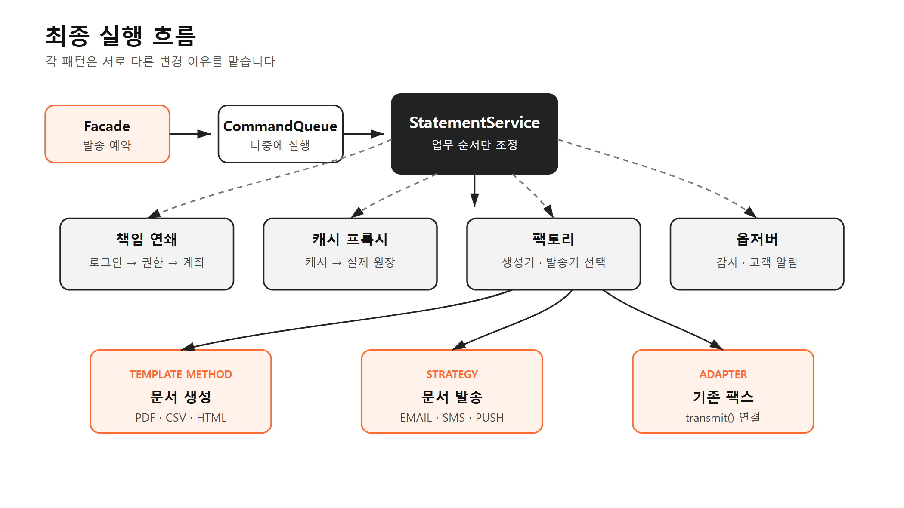

이 메서드는 패턴 이름을 나열하지 않는다. 검증, 조회, 생성, 발송, 완료 통지라는 업무 문장으로 읽힌다. 각 세부 정책은 주입된 객체와 팩토리 뒤에 있다.

<!-- pagebreak -->

# STEP 10 - 커맨드로 실행할 요청을 객체에 담는다

요청을 받은 즉시 실행하지 않고 큐에 저장하려면 실행에 필요한 상태를 객체로 묶는다.

```java
interface Command {
    void execute();
}

class SendStatementCommand implements Command {
    private final StatementUseCase statementUseCase;
    private final User user;
    private final StatementRequest request;

    SendStatementCommand(
            StatementUseCase statementUseCase,
            User user,
            StatementRequest request
    ) {
        this.statementUseCase = statementUseCase;
        this.user = user;
        this.request = request;
    }

    @Override
    public void execute() {
        statementUseCase.명세서를발송한다(user, request);
    }
}
```

큐는 어떤 요청인지 몰라도 `execute()`만 호출한다.

```java
class CommandQueue {
    private final Queue<Command> commands = new ArrayDeque<>();

    void 추가한다(Command command) {
        commands.offer(command);
    }

    void 모두실행한다() {
        while (!commands.isEmpty()) {
            commands.poll().execute();
            System.out.println();
        }
    }
}
```

커맨드 덕분에 요청 시점과 실행 시점이 분리된다. 나중에는 재시도 횟수, 요청 시간, 마지막 오류도 명령 객체에 담을 수 있다.

<!-- pagebreak -->

# STEP 10 - 퍼사드로 예약과 실행만 보여 준다

클라이언트가 커맨드 생성과 큐 사용을 모두 알 필요는 없다. 퍼사드는 두 개의 사용법만 제공한다.

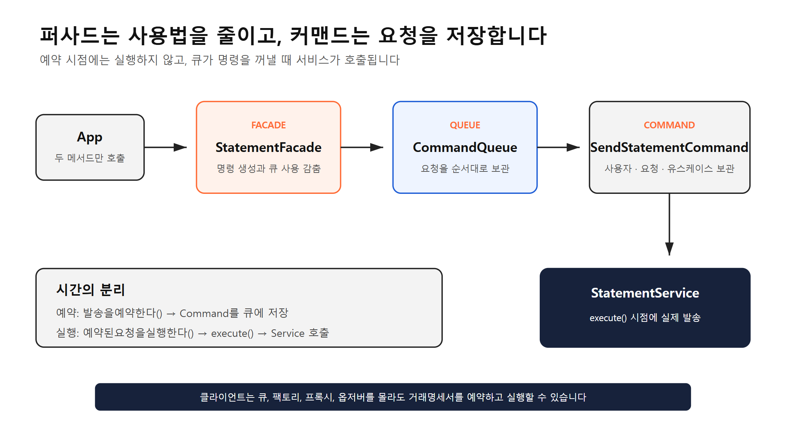

```java
class StatementFacade {
    private final StatementUseCase statementUseCase;
    private final CommandQueue commandQueue;

    StatementFacade(
            StatementUseCase statementUseCase,
            CommandQueue commandQueue
    ) {
        this.statementUseCase = statementUseCase;
        this.commandQueue = commandQueue;
    }

    void 발송을예약한다(User user, StatementRequest request) {
        commandQueue.추가한다(
                new SendStatementCommand(statementUseCase, user, request)
        );
        System.out.println("[예약] 거래명세서 발송 요청을 큐에 저장했습니다.");
    }

    void 예약된요청을실행한다() {
        commandQueue.모두실행한다();
    }
}
```

```java
StatementFacade facade = new StatementFacade(
        statementService,
        new CommandQueue()
);
```

| 패턴 | 이 단계에서 맡은 일 |
|---|---|
| 커맨드 | 실행에 필요한 상태를 객체로 저장 |
| 큐 | 커맨드를 보관하고 나중에 실행 |
| 퍼사드 | 명령 생성과 큐 사용을 단순한 메서드 뒤로 숨김 |

<!-- pagebreak -->

# STEP 10 - 세 요청을 예약한다

첫 번째 요청은 기존 기능인 `PDF + EMAIL`이다.

```java
facade.발송을예약한다(user, new StatementRequest(
        "110-123-456789", "2026-08",
        StatementFormat.PDF,
        DeliveryChannel.EMAIL,
        "customer@bank.com"
));
```

두 번째 요청은 새 기능인 `HTML + PUSH`다.

```java
facade.발송을예약한다(user, new StatementRequest(
        "110-123-456789", "2026-08",
        StatementFormat.HTML,
        DeliveryChannel.PUSH,
        "customer-device-token"
));
```

세 번째 요청은 어댑터를 확인하는 `CSV + FAX`다.

```java
facade.발송을예약한다(user, new StatementRequest(
        "110-123-456789", "2026-08",
        StatementFormat.CSV,
        DeliveryChannel.FAX,
        "051-000-0000"
));
```

마지막에 한 번 실행한다.

```java
facade.예약된요청을실행한다();
```

예약 시점에는 원장 조회나 문서 생성 출력이 없어야 한다. 세 개의 `[예약]`만 먼저 나타나면 커맨드가 실행 시점을 분리한 것이다.

<!-- pagebreak -->

# STEP 10 - 첫 요청에서 전체 흐름을 확인한다

```text
[시작] PDF / EMAIL
[검증] 로그인 확인
[검증] 직원 권한 확인
[검증] 계좌 접근 권한 확인
[캐시 MISS] 실제 원장 시스템을 조회합니다.
[원장 시스템] 110-123-456789 / 2026-08 거래내역 조회
[문서] 거래명세서 생성을 준비합니다.
[PDF] 은행 로고와 제목 작성
[PDF] 표로 작성: 입금 100,000원 / 출금 30,000원
[PDF] 안내 문구 작성
[이메일] customer@bank.com에게 발송: PDF 거래명세서
[감사] staff01의 발송 이력을 기록합니다.
[알림] customer@bank.com에게 발송 완료를 안내합니다.
```

출력을 패턴 이름이 아니라 호출 경계로 읽는다.

1. 책임 연쇄가 세 검증을 통과시킨다.
2. 프록시가 캐시를 확인하고 실제 원장을 호출한다.
3. 팩토리가 PDF 생성기와 이메일 발송기를 선택한다.
4. 템플릿 메서드가 PDF 생성 순서를 실행한다.
5. 발송 성공 뒤 발행자가 두 옵저버에게 알린다.

첫 요청의 조회 결과가 캐시에 저장되므로 같은 계좌와 기간을 사용하는 다음 요청부터는 실제 원장 출력이 나타나지 않는다.

<!-- pagebreak -->

# STEP 10 - 두 번째와 세 번째 요청으로 확장을 확인한다

두 번째 요청은 같은 조회 조건이므로 캐시를 사용한다.

```text
[시작] HTML / PUSH
[검증] 로그인 확인
[검증] 직원 권한 확인
[검증] 계좌 접근 권한 확인
[캐시 HIT] 저장된 거래내역을 반환합니다.
[문서] 거래명세서 생성을 준비합니다.
[HTML] 제목 태그 작성
[HTML] 테이블로 작성: 입금 100,000원 / 출금 30,000원
[HTML] 닫는 태그 작성
[푸시] customer-device-token에게 앱 알림 발송: HTML 거래명세서
[감사] staff01의 발송 이력을 기록합니다.
[알림] customer-device-token에게 발송 완료를 안내합니다.
```

세 번째 요청도 캐시를 사용하고, 발송 단계에서 어댑터가 기존 API를 호출한다.

```text
[시작] CSV / FAX
[검증] 로그인 확인
[검증] 직원 권한 확인
[검증] 계좌 접근 권한 확인
[캐시 HIT] 저장된 거래내역을 반환합니다.
[문서] 거래명세서 생성을 준비합니다.
[CSV] 열 이름 작성
[CSV] 행으로 작성: 입금 100,000원 / 출금 30,000원
[CSV] 마지막 줄 확인
[기존 팩스] 051-000-0000로 전송: CSV 거래명세서
[감사] staff01의 발송 이력을 기록합니다.
[알림] 051-000-0000에게 발송 완료를 안내합니다.
```

`StatementService`는 HTML, PUSH, `LegacyFaxClient`라는 구체 이름을 모른다. 이것이 최종 구조에서 확인할 OCP의 핵심이다.

<!-- pagebreak -->

# 최종 UML - 클래스보다 변경 방향을 읽는다

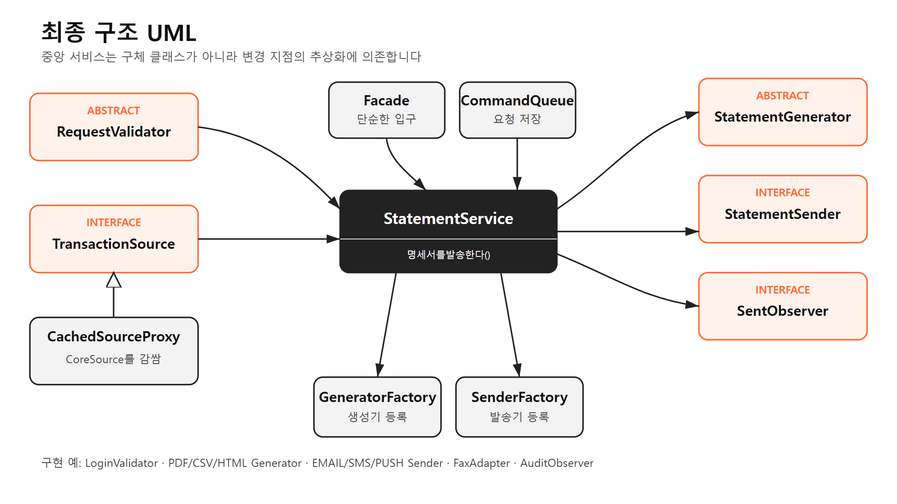

| 새 요구사항 | 추가하거나 교체할 객체 | 수정하지 않을 중심 코드 |
|---|---|---|
| 야간 발송 제한 | `RequestValidator` 구현 | `StatementService` |
| 다른 원장 조회 정책 | `TransactionSource` 구현 또는 프록시 | `StatementService` |
| JSON 문서 | `StatementGenerator` 구현과 등록 | 기존 생성기와 서비스 |
| 카카오 발송 | `StatementSender` 구현과 등록 | 기존 발송기와 서비스 |
| 보안 관제 알림 | `StatementSentObserver` 구현과 구독 | 발송 흐름 |
| 예약 우선순위 | 새 큐 정책 또는 커맨드 메타데이터 | 문서 생성과 발송 전략 |

클래스가 많아진 이유는 복잡성을 없앴기 때문이 아니다. 원래 한 메서드 안에 숨어 있던 변경 이유에 이름과 경계를 부여했기 때문이다.

## 의존성 방향

```text
App의 구성 루트
    -> 구체 구현을 생성하고 연결
StatementService
    -> 추상화와 팩토리만 사용
각 구현 클래스
    -> 자기 변경 이유만 담당
```

핵심 서비스가 구체 구현의 생성 책임까지 가지면 이 방향이 다시 뒤집힌다.

<!-- pagebreak -->

# 해설 실습 - JSON 문서를 서비스 수정 없이 추가한다

먼저 enum에 값을 추가한다.

```java
enum StatementFormat {
    PDF, CSV, HTML, JSON
}
```

템플릿 메서드의 네 변동 단계를 구현한다.

```java
class JsonStatementGenerator extends StatementGenerator {
    @Override
    protected void 머리말을작성한다() {
        System.out.println("[JSON] 객체 시작과 메타데이터 작성");
    }

    @Override
    protected void 거래내역을작성한다(String transactions) {
        System.out.println("[JSON] transactions 작성: " + transactions);
    }

    @Override
    protected void 꼬리말을작성한다() {
        System.out.println("[JSON] 객체 닫기");
    }

    @Override
    protected String 완성된문서() {
        return "JSON 거래명세서";
    }
}
```

구성 루트에 생성 방법을 등록한다.

```java
generatorFactory.등록한다(
        StatementFormat.JSON,
        JsonStatementGenerator::new
);
```

이 세 위치 외에 `StatementService.명세서를발송한다()`를 수정할 이유가 없다. 형식별 `if`를 서비스에 추가했다면 팩토리와 다형성을 우회한 것이다.

<!-- pagebreak -->

# 해설 실습 - KAKAO 발송과 보안 관제를 추가한다

발송 채널 enum에 값을 추가하고 전략을 구현한다.

```java
enum DeliveryChannel {
    EMAIL, SMS, FAX, PUSH, KAKAO
}

class KakaoStatementSender implements StatementSender {
    @Override
    public void 발송한다(String receiver, String document) {
        System.out.println(
                "[카카오] " + receiver + "에게 발송: " + document
        );
    }
}
```

팩토리에 등록한다.

```java
senderFactory.등록한다(
        DeliveryChannel.KAKAO,
        KakaoStatementSender::new
);
```

보안 관제는 발송 완료 이벤트에 반응하므로 옵저버로 추가한다.

```java
class SecurityMonitoringObserver implements StatementSentObserver {
    @Override
    public void 발송완료(StatementSentEvent event) {
        System.out.println(
                "[보안관제] " + event.userId + "의 발송을 알립니다."
        );
    }
}
```

```java
publisher.구독한다(new SecurityMonitoringObserver());
```

새 채널은 팩토리 등록으로, 새 후속 작업은 옵저버 구독으로 연결한다. 두 확장은 서로 다른 이유로 바뀌므로 같은 클래스에 합치지 않는다.

<!-- pagebreak -->

# 해설 실습 - 야간 검증을 체인에 끼운다

실제 시간 계산 대신 생성자에서 전달받은 값으로 야간 여부를 표현한다.

```java
class NightTimeValidator extends RequestValidator {
    private final boolean night;

    NightTimeValidator(boolean night) {
        this.night = night;
    }

    @Override
    protected boolean 현재검증을통과한다(
            User user,
            StatementRequest request
    ) {
        if (night) {
            System.out.println("[중단] 야간에는 발송할 수 없습니다.");
            return false;
        }
        System.out.println("[검증] 발송 가능 시간 확인");
        return true;
    }
}
```

검증 순서를 의식하며 체인에 연결한다.

```java
RequestValidator validationChain = new LoginValidator();
validationChain
        .setNext(new NightTimeValidator(false))
        .setNext(new RoleValidator())
        .setNext(new AccountValidator());
```

`night`를 `true`로 바꾸어 실행하면 다음 출력 뒤에 원장 조회가 없어야 한다.

```text
[검증] 로그인 확인
[중단] 야간에는 발송할 수 없습니다.
```

검증 객체를 추가했지만 핵심 서비스의 검증 호출은 그대로다.

<!-- pagebreak -->

# 완성 검증 - 코드가 아니라 변화 비용을 확인한다

다음 순서로 최종 코드를 검증한다.

1. `step10/App.java`를 컴파일하고 실행한다.
2. 세 요청이 예약된 뒤에야 첫 `[시작]`이 출력되는지 확인한다.
3. 실제 원장 조회가 한 번만 출력되는지 확인한다.
4. HTML과 PUSH가 기존 PDF, EMAIL 코드 수정 없이 실행되는지 확인한다.
5. FAX 요청에서 `LegacyFaxClient.transmit()`의 출력이 나타나는지 확인한다.
6. 모든 정상 발송 뒤 감사와 고객 알림이 실행되는지 확인한다.
7. 계좌 검증을 실패시키고 원장 조회가 실행되지 않는지 확인한다.

## 구조 점검표

- 서비스 메서드는 업무 순서만 보여 주는가?
- 새 문서 형식을 추가할 때 서비스의 `if`가 늘어나지 않는가?
- 외부 팩스 API의 `transmit()`이 어댑터 밖으로 나오지 않는가?
- 검증 실패 뒤 조회, 생성, 발송이 모두 멈추는가?
- 발송 후 작업을 추가할 때 서비스가 바뀌지 않는가?
- 같은 계좌와 기간의 두 번째 조회가 캐시 HIT가 되는가?
- 커맨드를 큐에 넣는 시점과 실행하는 시점이 분리되어 있는가?
- 클라이언트가 퍼사드의 예약과 실행 메서드만 사용해도 되는가?

이 점검을 통과하면 패턴을 사용했다는 사실보다 더 중요한 결과를 얻은 것이다. 새 요구사항이 들어왔을 때 어느 클래스를 추가하거나 교체해야 하는지가 분명해진다.

<!-- pagebreak -->

# 패턴 선택 지도 - 문제 문장에서 출발한다

| 반복해서 나타나는 문제 | 먼저 검토할 구조 | 이 예제의 위치 |
|---|---|---|
| 실행 방법을 교체하고 싶다 | 전략 | 문서 생성기와 발송기 |
| 전체 순서는 같고 일부 표현만 다르다 | 템플릿 메서드 | 문서 생성 과정 |
| 타입에 맞는 구현체를 얻고 싶다 | 팩토리 | 형식과 채널 선택 |
| 기존 API의 호출 규격이 다르다 | 어댑터 | 기존 팩스 연결 |
| 검사를 순서대로 통과시키고 싶다 | 책임 연쇄 | 요청 검증 |
| 같은 계약 앞에 캐시나 접근 제어를 끼우고 싶다 | 프록시 | 원장 조회 캐시 |
| 완료 사실에 여러 작업이 반응한다 | 옵저버 | 감사와 고객 알림 |
| 요청을 저장하고 나중에 실행한다 | 커맨드 | 발송 요청 큐 |
| 복잡한 하위 구조에 단순한 창구를 제공한다 | 퍼사드 | 예약과 실행 API |

패턴을 먼저 고르고 문제를 끼워 맞추지 않는다. 변경 요청이 반복되는 지점을 찾고, 그 변경을 기존 핵심 코드에서 분리해야 할 때 패턴을 선택한다.

문서 형식이 PDF 하나이고 발송 채널도 이메일 하나로 영원히 고정되어 있다면 팩토리와 전략은 과할 수 있다. 패턴은 미래의 모든 가능성을 미리 구현하는 장식이 아니라, 이미 확인된 변화에 대응하는 구조다.

<!-- pagebreak -->

# 마지막 정리 - step1에서 step10으로 무엇이 이동했는가

| step1의 위치 | step10에서 책임을 맡은 객체 |
|---|---|
| 로그인과 권한 `if` | `RequestValidator` 체인 |
| 원장 조회 코드 | `TransactionSource`와 캐시 프록시 |
| PDF, CSV 생성 분기 | 생성기 계층과 `GeneratorFactory` |
| EMAIL, SMS, FAX 분기 | 발송 전략과 `SenderFactory` |
| 기존 팩스 직접 호출 | `FaxStatementSenderAdapter` |
| 감사 기록 직접 호출 | 발송 완료 옵저버 |
| 즉시 실행 | `SendStatementCommand`와 `CommandQueue` |
| 복잡한 조립 노출 | `StatementFacade` |

리팩터링 전후의 핵심 차이는 코드 줄 수가 아니다.

```text
step1
변경 요청 -> LegacyStatementService 수정

step10
변경 요청 -> 해당 확장점의 새 객체 추가 또는 교체
          -> 구성 루트에서 연결
          -> StatementService는 업무 순서를 유지
```

이제 `step1/App.java`를 다시 열어 본다. 처음에는 길고 복잡한 메서드로만 보였던 코드가 검증, 조회, 생성, 선택, 발송, 후속 작업, 실행 제어라는 서로 다른 변화 축으로 보이면 이 실습의 목적을 달성한 것이다.
