# 거래명세서 한 건이 발송되기까지

이 실습은 이미 운영 중인 거래명세서 발송 코드를 리팩터링하는 과정이다. 직원이 계좌와 조회 기간을 입력하면 시스템은 접근 권한을 확인하고, 원장에서 거래내역을 조회하고, 문서를 만든 뒤 고객이 선택한 채널로 발송한다. 발송이 끝나면 감사 기록과 고객 알림도 남긴다.

문서 생성기와 외부 연동 모듈은 실제 파일과 네트워크 대신 콘솔에 처리 결과를 출력한다. 이후 단계에서는 **요구사항이 추가될 때 변경되는 클래스**를 추적한다.

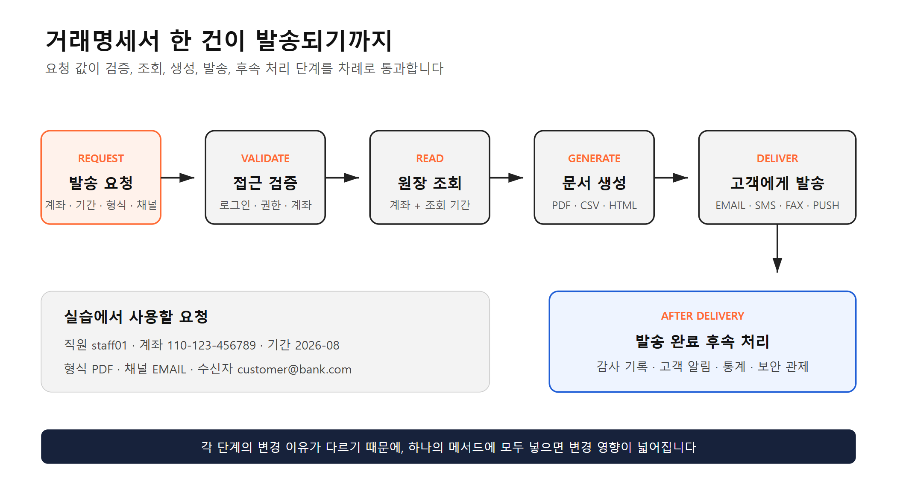

## 실습에서 사용할 요청 값

| 항목 | 예시 값 | 코드에서 사용하는 필드 |
|---|---|---|
| 요청 직원 | `staff01` | `User.id` |
| 대상 계좌 | `110-123-456789` | `StatementRequest.accountNo` |
| 조회 기간 | `2026-08` | `StatementRequest.period` |
| 문서 형식 | `PDF` | `StatementRequest.format` |
| 발송 채널 | `EMAIL` | `StatementRequest.channel` |
| 수신자 | `customer@bank.com` | `StatementRequest.receiver` |

정상 요청 한 건은 다음 순서로 처리된다.

```text
[검증] 로그인 확인
[검증] 직원 권한 확인
[검증] 계좌 접근 권한 확인
[원장 시스템] 거래내역 조회
[PDF] 거래명세서 생성
[이메일] 고객에게 발송
[감사] 직원 발송 이력 기록
[알림] 고객에게 발송 완료 안내
```

이 흐름을 한 메서드에서 시작해 열 단계로 나눈다. 최종 목표는 `HTML`, `PUSH`, 새로운 검증, 새로운 후속 작업을 추가해도 핵심 업무 클래스인 `StatementService`를 수정하지 않는 것이다.

<!-- pagebreak -->

# 전체 리팩터링 경로

한 번에 완성된 구조로 건너뛰지 않는다. 현재 코드에서 실제로 불편한 지점을 확인한 다음, 그 문제를 해결하는 원칙이나 패턴을 하나씩 적용한다.

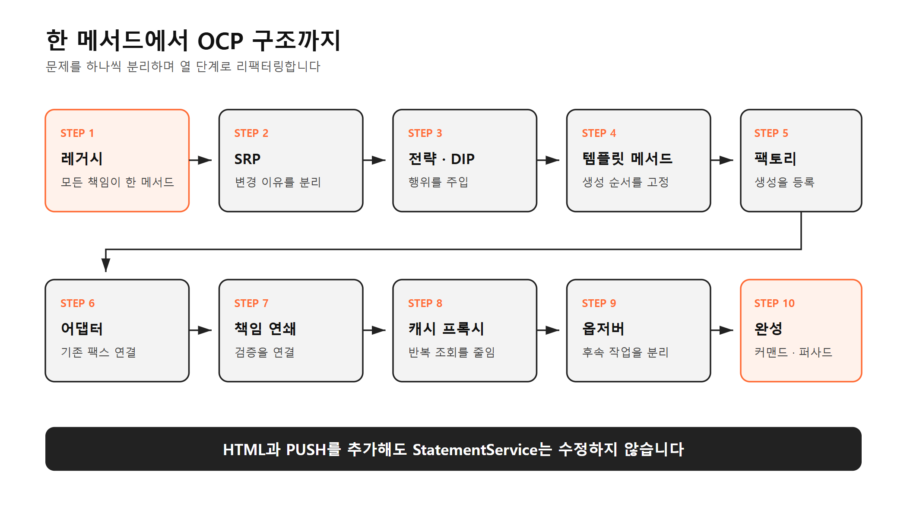

| 단계 | 코드에서 발견한 문제 | 적용 내용 | 변화가 생기는 위치 |
|---|---|---|---|
| 1 | 모든 책임이 한 메서드에 섞임 | 레거시 상태 확인 | `LegacyStatementService` |
| 2 | 변경 이유가 한 클래스에 모임 | SRP | 검증·조회·생성·발송 클래스로 분리 |
| 3 | 서비스가 구체 구현을 선택함 | 전략, DIP | 생성기·발송기 인터페이스 |
| 4 | 문서 생성 순서가 중복됨 | 템플릿 메서드 | 생성 순서는 상위 클래스 |
| 5 | 형식과 채널 선택 분기가 늘어남 | 팩토리 | 구현체 등록과 선택 |
| 6 | 기존 팩스 API의 규격이 다름 | 어댑터 | 팩스 API 변환 객체 |
| 7 | 검증 추가로 서비스가 계속 바뀜 | 책임 연쇄 | 독립된 검증기 체인 |
| 8 | 같은 원장 조회가 반복됨 | 캐시 프록시 | 조회 앞의 대리 객체 |
| 9 | 발송 후 작업이 계속 늘어남 | 옵저버 | 발송 완료 구독자 |
| 10 | 요청 저장과 조립 과정이 복잡함 | 커맨드, 퍼사드 | 큐와 단순한 사용 창구 |

각 단계는 독립 실행 예제다. 예를 들어 7단계를 실행하려면 다음과 같이 컴파일한다.

```powershell
javac -encoding UTF-8 -d out src/ex15/step7/App.java
java -cp out ex15.step7.App
```

코드를 읽을 때는 클래스 개수보다 **변경 요청이 들어오면 어느 파일을 열게 되는가**를 계속 확인한다.

<!-- pagebreak -->

# STEP 1 — 변경할 때마다 커지는 레거시 메서드

소스: [step1/App.java](../src/ex15/step1/App.java)

`LegacyStatementService.명세서를발송한다()`는 다음 여섯 가지 일을 수행한다.

1. 로그인 여부를 검사한다.
2. 거래명세서 발송 권한을 검사한다.
3. 원장에서 거래내역을 조회한다.
4. PDF 또는 CSV 문서를 만든다.
5. 이메일, 문자, 팩스 중 하나로 발송한다.
6. 감사 이력을 기록한다.

처음 두 검증과 원장 조회부터 살펴보자.

```java
void 명세서를발송한다(User user, StatementRequest request) {
    System.out.println("[요청] 거래명세서 발송을 시작합니다.");

    if (!user.login) {
        System.out.println("[중단] 로그인이 필요합니다.");
        return;
    }

    if (!user.statementManager) {
        System.out.println("[중단] 거래명세서 발송 권한이 없습니다.");
        return;
    }

    System.out.println(
            "[원장] " + request.accountNo + " / " + request.period + " 조회"
    );
    String transactions = "입금 100,000원 / 출금 30,000원";
```

문서 형식은 문자열 분기로 선택한다.

```java
String document;
if (request.format.equals("PDF")) {
    System.out.println("[PDF] 머리말 작성");
    System.out.println("[PDF] 거래내역 작성: " + transactions);
    System.out.println("[PDF] 꼬리말 작성");
    document = "PDF 거래명세서";
} else if (request.format.equals("CSV")) {
    System.out.println("[CSV] 열 이름 작성");
    System.out.println("[CSV] 거래내역 작성: " + transactions);
    System.out.println("[CSV] 파일 마감");
    document = "CSV 거래명세서";
} else {
    System.out.println("[중단] 지원하지 않는 문서 형식입니다.");
    return;
}
```

<!-- pagebreak -->

# STEP 1 — 발송 채널까지 같은 메서드에 들어 있다

문서를 만들고 나면 다시 문자열 분기로 발송 채널을 선택한다. 팩스는 기존 API를 직접 생성하고 호출한다.

```java
if (request.channel.equals("EMAIL")) {
    System.out.println("[이메일] " + user.id + "에게 발송: " + document);
} else if (request.channel.equals("SMS")) {
    System.out.println("[문자] 다운로드 링크 발송: " + document);
} else if (request.channel.equals("FAX")) {
    LegacyFaxClient faxClient = new LegacyFaxClient();
    faxClient.transmit("051-000-0000", document);
} else {
    System.out.println("[중단] 지원하지 않는 발송 채널입니다.");
    return;
}

System.out.println("[감사] " + user.id + "의 발송 이력을 기록합니다.");
```

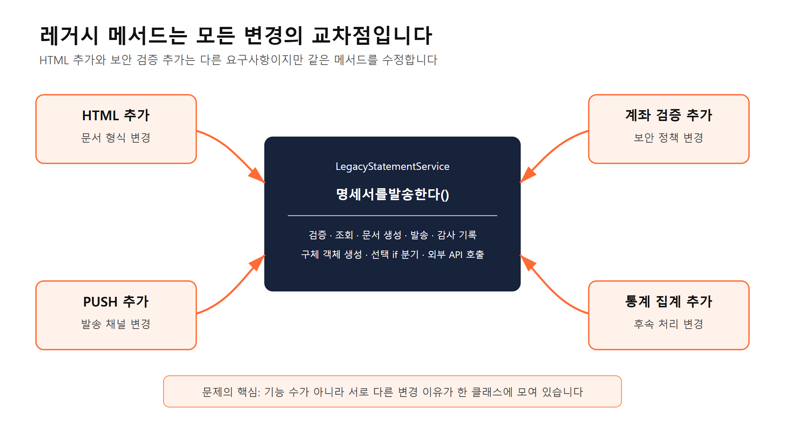

## 네 가지 요구사항을 적용하면 어디를 수정하게 되는가

| 새 요구사항 | 실제 수정 지점 | 함께 다시 확인하게 되는 코드 |
|---|---|---|
| HTML 문서 추가 | 문서 형식 `if` 분기 | 검증, 조회, 발송, 감사 기록 |
| PUSH 발송 추가 | 발송 채널 `if` 분기 | 검증, 조회, 문서 생성, 감사 기록 |
| 계좌 접근 검사 추가 | 메서드 앞부분 | 모든 정상·실패 경로 |
| 발송 통계 추가 | 메서드 마지막 | 발송 성공과 실패 경로 |

OCP 위반이라는 결론부터 외우지 않는다. 먼저 이 클래스가 **서로 다른 네 가지 이유로 계속 바뀐다**는 사실을 확인한다. 수정 범위가 넓기 때문에 HTML 추가가 팩스 발송 회귀 테스트로 이어진다.

> STEP 1의 실습 목표는 코드를 예쁘게 만드는 것이 아니다. 변경 요청 하나가 들어왔을 때 관련 없는 코드까지 다시 읽고 테스트해야 하는 비용을 발견하는 것이다.

<!-- pagebreak -->

# STEP 2 — 먼저 책임을 클래스 단위로 나눈다

소스: [step2/App.java](../src/ex15/step2/App.java)

패턴을 적용하기 전에 SRP로 역할부터 나눈다.

| 클래스 | 맡은 책임 | 변경되는 이유 |
|---|---|---|
| `AccessChecker` | 로그인과 직원 권한 검사 | 접근 정책 변경 |
| `TransactionReader` | 원장 거래내역 조회 | 원장 연결 방식 변경 |
| `PdfStatementGenerator` | PDF 문서 생성 | PDF 양식 변경 |
| `EmailStatementSender` | 이메일 발송 | 이메일 시스템 변경 |
| `AuditLogger` | 감사 이력 기록 | 감사 정책 변경 |

서비스는 세부 구현 대신 업무 순서를 보여 준다.

```java
class StatementService {
    void 명세서를발송한다(User user, StatementRequest request) {
        AccessChecker accessChecker = new AccessChecker();
        TransactionReader transactionReader = new TransactionReader();
        PdfStatementGenerator generator = new PdfStatementGenerator();
        EmailStatementSender sender = new EmailStatementSender();
        AuditLogger auditLogger = new AuditLogger();

        if (!accessChecker.접근가능하다(user)) {
            return;
        }

        String transactions = transactionReader.거래내역조회(
                request.accountNo,
                request.period
        );
        String document = generator.생성한다(transactions);
        sender.발송한다(user.id, document);
        auditLogger.기록한다(user.id);
    }
}
```

## 좋아진 점과 남은 문제

`AuditLogger`의 출력 형식을 바꾸는 일은 이제 `PdfStatementGenerator`와 분리되어 있다. 하지만 `StatementService`가 모든 구현체를 직접 `new`로 만든다. PDF를 CSV로 바꾸거나 이메일을 문자로 바꾸려면 여전히 서비스 코드를 수정해야 한다.

```java
// 아직 서비스가 구체 구현을 결정한다.
PdfStatementGenerator generator = new PdfStatementGenerator();
EmailStatementSender sender = new EmailStatementSender();
```

SRP는 책임을 나누지만 자동으로 OCP와 DIP까지 해결하지 않는다. 다음 단계에서는 **바뀌는 두 행위**를 인터페이스 뒤로 옮긴다.

<!-- pagebreak -->

# STEP 3 — 바뀌는 행위를 전략으로 주입한다

소스: [step3/App.java](../src/ex15/step3/App.java)

문서 생성과 발송은 실행할 때 교체할 수 있는 행위다. 두 행위를 각각 인터페이스로 만든다.

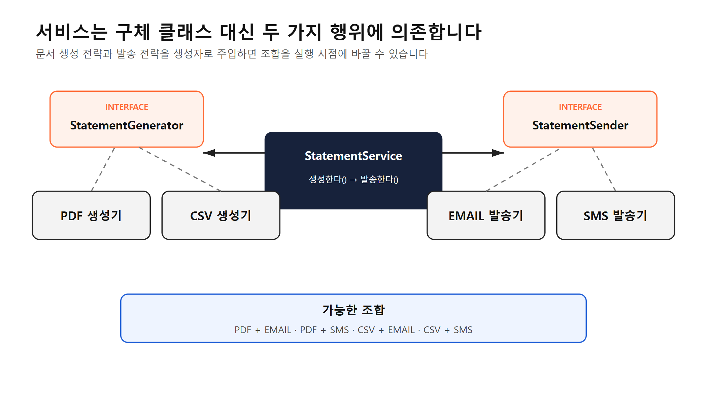

```java
interface StatementGenerator {
    String 생성한다(String transactions);
}

interface StatementSender {
    void 발송한다(String receiver, String document);
}
```

서비스는 두 인터페이스를 생성자로 전달받는다.

```java
class StatementService {
    private final StatementGenerator generator;
    private final StatementSender sender;

    StatementService(
            StatementGenerator generator,
            StatementSender sender
    ) {
        this.generator = generator;
        this.sender = sender;
    }

    void 명세서를발송한다(String receiver, String transactions) {
        String document = generator.생성한다(transactions);
        sender.발송한다(receiver, document);
    }
}
```

구체 구현을 선택하는 일은 조립 코드로 이동한다.

```java
StatementService emailPdfService = new StatementService(
        new PdfStatementGenerator(),
        new EmailStatementSender()
);

StatementService smsCsvService = new StatementService(
        new CsvStatementGenerator(),
        new SmsStatementSender()
);
```

같은 서비스 코드로 `PDF + EMAIL`, `CSV + SMS` 조합을 실행할 수 있다. 전략 패턴은 교체 가능한 행위를 객체로 만들고, DIP는 서비스가 구체 클래스가 아니라 그 행위의 추상화에 의존하게 한다.

<!-- pagebreak -->

# STEP 3 — 실행 결과와 테스트 가능성 확인

두 전략 조합을 실행하면 결과가 다음과 같이 달라진다.

```text
[PDF] 거래명세서 생성: 입금 100,000원 / 출금 30,000원
[이메일] customer@bank.com에게 발송: PDF 거래명세서

[CSV] 거래명세서 생성: 입금 100,000원 / 출금 30,000원
[문자] 010-0000-0000에게 다운로드 링크 발송: CSV 거래명세서
```

전략으로 분리하면 테스트에서도 실제 이메일 시스템을 호출할 필요가 없다.

```java
class FakeStatementSender implements StatementSender {
    String receivedDocument;

    @Override
    public void 발송한다(String receiver, String document) {
        this.receivedDocument = document;
    }
}

FakeStatementSender fakeSender = new FakeStatementSender();
StatementService service = new StatementService(
        new PdfStatementGenerator(),
        fakeSender
);

service.명세서를발송한다(
        "customer@bank.com",
        "입금 100,000원"
);

System.out.println(fakeSender.receivedDocument);
// PDF 거래명세서
```

전략을 추가할 때 지켜야 하는 기준은 단순하다.

- 새 생성기는 `StatementGenerator`의 계약을 지킨다.
- 새 발송기는 `StatementSender`의 계약을 지킨다.
- `StatementService`는 새 구현체의 클래스 이름을 모른다.
- 조립 코드에서 원하는 구현체를 전달한다.

<!-- pagebreak -->

# STEP 4 — 문서 생성 순서는 템플릿으로 고정한다

소스: [step4/App.java](../src/ex15/step4/App.java)

PDF와 CSV는 결과 표현이 다르지만 생성 순서는 같다. 준비하고, 머리말을 쓰고, 거래내역을 쓰고, 꼬리말을 쓴 뒤 결과를 반환한다.

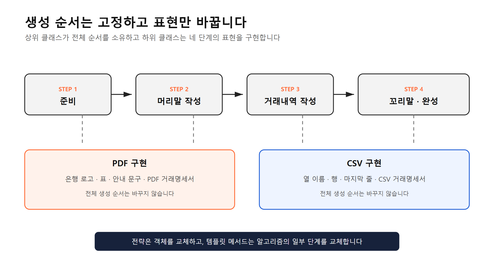

상위 클래스가 전체 순서를 소유한다.

```java
abstract class StatementGenerator {

    public final String 생성한다(String transactions) {
        준비한다();
        머리말을작성한다();
        거래내역을작성한다(transactions);
        꼬리말을작성한다();
        return 완성된문서();
    }

    private void 준비한다() {
        System.out.println("[공통] 거래명세서 생성을 준비합니다.");
    }

    protected abstract void 머리말을작성한다();
    protected abstract void 거래내역을작성한다(String transactions);
    protected abstract void 꼬리말을작성한다();
    protected abstract String 완성된문서();
}
```

`생성한다()`가 `final`이므로 하위 클래스는 전체 순서를 바꿀 수 없다. 대신 네 개의 세부 단계를 구현한다.

```java
class PdfStatementGenerator extends StatementGenerator {
    @Override
    protected void 머리말을작성한다() {
        System.out.println("[PDF] 은행 로고와 제목을 작성합니다.");
    }

    @Override
    protected void 거래내역을작성한다(String transactions) {
        System.out.println("[PDF] 표로 작성: " + transactions);
    }

    @Override
    protected void 꼬리말을작성한다() {
        System.out.println("[PDF] 안내 문구를 작성합니다.");
    }

    @Override
    protected String 완성된문서() {
        return "PDF 거래명세서";
    }
}
```

<!-- pagebreak -->

# STEP 4 — 전략과 템플릿 메서드를 구분한다

CSV 생성기는 같은 단계에서 다른 표현을 만든다.

```java
class CsvStatementGenerator extends StatementGenerator {
    @Override
    protected void 머리말을작성한다() {
        System.out.println("[CSV] 열 이름을 작성합니다.");
    }

    @Override
    protected void 거래내역을작성한다(String transactions) {
        System.out.println("[CSV] 행으로 작성: " + transactions);
    }

    @Override
    protected void 꼬리말을작성한다() {
        System.out.println("[CSV] 마지막 줄을 확인합니다.");
    }

    @Override
    protected String 완성된문서() {
        return "CSV 거래명세서";
    }
}
```

| 구분 | 전략 패턴 | 템플릿 메서드 패턴 |
|---|---|---|
| 교체 단위 | 행위를 수행하는 객체 전체 | 알고리즘을 구성하는 일부 단계 |
| 주요 수단 | 인터페이스와 합성 | 추상 클래스와 상속 |
| 이 예제 | 발송기, 생성기 선택 | 문서 생성 순서 |
| 변경 방법 | 다른 객체를 주입 | 다른 하위 클래스를 추가 |

실행 결과를 보면 공통 순서는 같고 표현만 달라진다.

```text
[공통] 거래명세서 생성을 준비합니다.
[PDF] 은행 로고와 제목을 작성합니다.
[PDF] 표로 작성: 입금 100,000원 / 출금 30,000원
[PDF] 안내 문구를 작성합니다.
완성: PDF 거래명세서
```

HTML을 추가할 때도 상위 클래스의 순서를 수정하지 않는다. `HtmlStatementGenerator`가 네 단계의 HTML 표현만 구현하면 된다.

<!-- pagebreak -->

# STEP 5 — 선택 분기를 팩토리로 옮긴다

소스: [step5/App.java](../src/ex15/step5/App.java)

전략을 만들었어도 요청의 `format`과 `channel`을 보고 구현체를 선택하는 코드가 필요하다. 팩토리는 타입과 생성 방법을 등록해 두고 필요한 객체를 반환한다.

```java
enum StatementFormat {
    PDF, CSV
}

class GeneratorFactory {
    private final Map<StatementFormat, Supplier<StatementGenerator>> creators
            = new HashMap<>();

    void 등록한다(
            StatementFormat format,
            Supplier<StatementGenerator> creator
    ) {
        creators.put(format, creator);
    }

    StatementGenerator 생성한다(StatementFormat format) {
        Supplier<StatementGenerator> creator = creators.get(format);

        if (creator == null) {
            throw new IllegalArgumentException(
                    "지원하지 않는 문서 형식: " + format
            );
        }
        return creator.get();
    }
}
```

애플리케이션 시작 지점에서 생성 방법을 등록한다.

```java
GeneratorFactory generatorFactory = new GeneratorFactory();
generatorFactory.등록한다(
        StatementFormat.PDF,
        PdfStatementGenerator::new
);
generatorFactory.등록한다(
        StatementFormat.CSV,
        CsvStatementGenerator::new
);

StatementGenerator generator = generatorFactory.생성한다(
        StatementFormat.PDF
);
```

OCP는 프로그램의 모든 파일을 절대 수정하지 않는다는 뜻이 아니다. 새 형식을 추가하면 enum과 조립 코드는 바뀔 수 있다. 중요한 점은 **발송 업무의 중심 코드가 선택 분기와 구체 클래스 이름으로부터 보호된다**는 것이다.

<!-- pagebreak -->

# STEP 5 — TEXT 형식을 추가해 OCP를 확인한다

먼저 형식을 추가하고 생성기를 구현한다.

```java
enum StatementFormat {
    PDF, CSV, TEXT
}

class TextStatementGenerator implements StatementGenerator {
    @Override
    public String 생성한다(String transactions) {
        System.out.println("[TEXT] 거래내역 작성: " + transactions);
        return "TEXT 거래명세서";
    }
}
```

조립 코드에 생성 방법을 한 줄 등록한다.

```java
generatorFactory.등록한다(
        StatementFormat.TEXT,
        TextStatementGenerator::new
);
```

서비스가 팩토리를 사용하면 업무 메서드에는 형식별 분기가 없다.

```java
void 명세서를발송한다(
        StatementFormat format,
        DeliveryChannel channel,
        String receiver,
        String transactions
) {
    StatementGenerator generator = generatorFactory.생성한다(format);
    StatementSender sender = senderFactory.생성한다(channel);

    String document = generator.생성한다(transactions);
    sender.발송한다(receiver, document);
}
```

확인할 것은 “파일을 몇 개 수정했는가”보다 “기존 업무 로직을 다시 수정했는가”이다. `TEXT` 추가 때문에 `StatementService` 내부에 `else if`가 생겼다면 팩토리의 이점을 얻지 못한 것이다.

<!-- pagebreak -->

# STEP 6 — 수정할 수 없는 팩스 API를 연결한다

소스: [step6/App.java](../src/ex15/step6/App.java)

새 시스템은 모든 발송기를 `StatementSender`로 사용한다. 하지만 이미 운영 중인 팩스 클라이언트는 메서드 이름이 다르다.

```java
interface StatementSender {
    void 발송한다(String receiver, String document);
}

// 외부 라이브러리라고 가정한다. 수정할 수 없다.
class LegacyFaxClient {
    void transmit(String phoneNumber, String payload) {
        System.out.println(
                "[기존 팩스] " + phoneNumber + "로 전송: " + payload
        );
    }
}
```

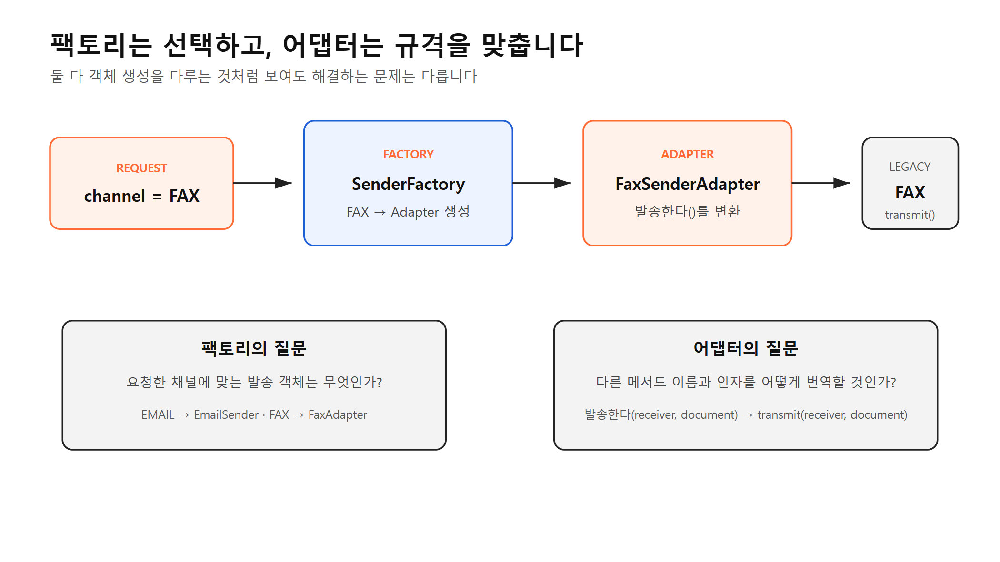

어댑터는 새 시스템의 호출을 기존 팩스 API 호출로 바꾼다.

```java
class FaxStatementSenderAdapter implements StatementSender {
    private final LegacyFaxClient faxClient;

    FaxStatementSenderAdapter(LegacyFaxClient faxClient) {
        this.faxClient = faxClient;
    }

    @Override
    public void 발송한다(String receiver, String document) {
        faxClient.transmit(receiver, document);
    }
}
```

| 새 시스템이 전달하는 값 | 어댑터가 넘기는 위치 | 기존 팩스 API |
|---|---|---|
| `receiver` | 첫 번째 인자 | `phoneNumber` |
| `document` | 두 번째 인자 | `payload` |
| `발송한다()` | 메서드 호출 변환 | `transmit()` |

팩토리에는 팩스 클라이언트를 가진 어댑터 생성 방법을 등록한다.

```java
LegacyFaxClient faxClient = new LegacyFaxClient();

senderFactory.등록한다(
        DeliveryChannel.FAX,
        () -> new FaxStatementSenderAdapter(faxClient)
);
```

`StatementService`는 팩스가 외부 시스템인지, 메서드 이름이 `transmit()`인지 알지 못한다.

<!-- pagebreak -->

# STEP 7 — 검증은 책임 연쇄로 연결한다

소스: [step7/App.java](../src/ex15/step7/App.java)

검증은 정해진 순서로 실행되고 어느 단계에서든 실패하면 즉시 멈춘다. 로그인, 직원 권한, 계좌 접근 권한을 각각 독립된 검사 객체로 만든다.

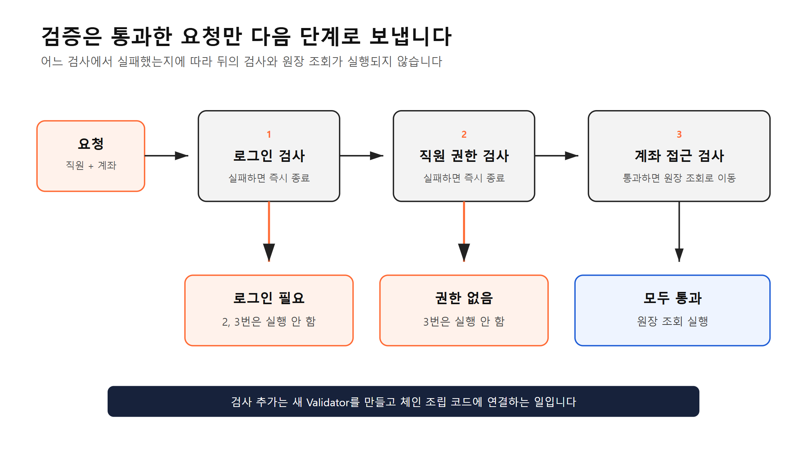

상위 클래스는 현재 검사를 실행하고 다음 검사로 넘기는 공통 흐름을 가진다.

```java
abstract class RequestValidator {
    private RequestValidator next;

    RequestValidator setNext(RequestValidator next) {
        this.next = next;
        return next;
    }

    public final boolean 검증한다(User user, StatementRequest request) {
        if (!현재검증을통과한다(user, request)) {
            return false;
        }

        return next == null || next.검증한다(user, request);
    }

    protected abstract boolean 현재검증을통과한다(
            User user,
            StatementRequest request
    );
}
```

각 하위 클래스는 한 가지 검사만 수행한다.

```java
class AccountValidator extends RequestValidator {
    @Override
    protected boolean 현재검증을통과한다(
            User user,
            StatementRequest request
    ) {
        if (!user.allowedAccountNo.equals(request.accountNo)) {
            System.out.println("[중단] 이 계좌에 접근할 수 없습니다.");
            return false;
        }

        System.out.println("[통과] 계좌 접근 권한 확인");
        return true;
    }
}
```

<!-- pagebreak -->

# STEP 7 — 실패 위치에 따라 실행 결과가 달라진다

체인의 시작 객체는 별도로 보관한다. `setNext()`는 새로 연결한 객체를 반환하므로 이어서 호출하면 자연스럽게 체인을 만들 수 있다.

```java
RequestValidator validationChain = new LoginValidator();
validationChain
        .setNext(new RoleValidator())
        .setNext(new AccountValidator());
```

접근할 수 없는 계좌를 요청하면 세 번째 검사에서 멈춘다.

```text
[통과] 로그인 확인
[통과] 직원 권한 확인
[중단] 이 계좌에 접근할 수 없습니다.
검증 결과: false
```

허용된 계좌라면 모든 검사를 통과한다.

```text
[통과] 로그인 확인
[통과] 직원 권한 확인
[통과] 계좌 접근 권한 확인
검증 결과: true
```

새로운 업무시간 검증은 다음과 같이 추가할 수 있다.

```java
class BusinessHourValidator extends RequestValidator {
    private final boolean businessHour;

    BusinessHourValidator(boolean businessHour) {
        this.businessHour = businessHour;
    }

    @Override
    protected boolean 현재검증을통과한다(
            User user,
            StatementRequest request
    ) {
        if (!businessHour) {
            System.out.println("[중단] 업무시간에만 발송할 수 있습니다.");
            return false;
        }
        System.out.println("[통과] 업무시간 확인");
        return true;
    }
}
```

검증기를 만든 뒤 원하는 위치에 연결한다. 기존 검증 클래스와 발송 서비스는 수정하지 않는다.

<!-- pagebreak -->

# STEP 8 — 프록시는 반복되는 원장 조회를 줄인다

소스: [step8/App.java](../src/ex15/step8/App.java)

원장 조회는 외부 시스템 호출이라고 가정한다. 같은 계좌와 기간으로 여러 문서 형식을 발송하면 동일한 거래내역을 반복해서 읽게 된다.

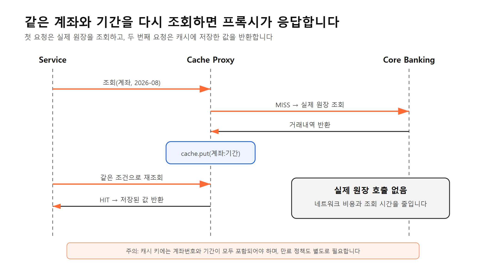

실제 객체와 프록시는 같은 인터페이스를 구현한다.

```java
interface TransactionSource {
    String 거래내역조회(String accountNo, String period);
}

class CoreBankingTransactionSource implements TransactionSource {
    @Override
    public String 거래내역조회(String accountNo, String period) {
        System.out.println(
                "[원장 시스템] " + accountNo + " / " + period + " 조회"
        );
        return "입금 100,000원 / 출금 30,000원";
    }
}
```

프록시는 먼저 캐시를 확인하고 필요할 때만 실제 객체를 호출한다.

```java
class CachedTransactionSourceProxy implements TransactionSource {
    private final TransactionSource target;
    private final Map<String, String> cache = new HashMap<>();

    CachedTransactionSourceProxy(TransactionSource target) {
        this.target = target;
    }

    @Override
    public String 거래내역조회(String accountNo, String period) {
        String key = accountNo + ":" + period;

        if (cache.containsKey(key)) {
            System.out.println("[캐시 HIT] 저장된 거래내역을 반환합니다.");
            return cache.get(key);
        }

        System.out.println("[캐시 MISS] 실제 원장 시스템을 조회합니다.");
        String transactions = target.거래내역조회(accountNo, period);
        cache.put(key, transactions);
        return transactions;
    }
}
```

<!-- pagebreak -->

# STEP 8 — 첫 번째 호출과 두 번째 호출을 비교한다

클라이언트는 실제 객체 대신 프록시를 사용한다.

```java
TransactionSource source = new CachedTransactionSourceProxy(
        new CoreBankingTransactionSource()
);

source.거래내역조회("110-123-456789", "2026-08");
source.거래내역조회("110-123-456789", "2026-08");
```

실행 결과에서 실제 원장 조회는 한 번만 나타난다.

```text
[캐시 MISS] 실제 원장 시스템을 조회합니다.
[원장 시스템] 110-123-456789 / 2026-08 거래내역 조회

[캐시 HIT] 저장된 거래내역을 반환합니다.
```

캐시 프록시를 구현할 때는 패턴 이름보다 데이터 정책을 먼저 확인해야 한다.

| 확인 항목 | 잘못 구현했을 때 생기는 문제 |
|---|---|
| 캐시 키 | 기간을 빼면 다른 달의 거래내역을 반환할 수 있음 |
| 만료 시간 | 원장이 바뀌어도 오래된 값을 계속 반환할 수 있음 |
| 동시 접근 | 여러 스레드가 같은 값을 중복 조회할 수 있음 |
| 오류 캐싱 | 일시적인 조회 실패를 정상 결과처럼 저장할 수 있음 |

`HashMap` 기반의 인메모리 캐시는 만료, 동시성, 메모리 제한, 원장 변경 시 무효화 정책을 제공하지 않는다. 운영 환경에서는 이러한 정책을 별도로 설계해야 한다.

<!-- pagebreak -->

# STEP 9 — 발송 뒤의 일은 옵저버에게 알린다

소스: [step9/App.java](../src/ex15/step9/App.java)

발송이 성공하면 감사 기록, 고객 알림, 통계 집계가 실행된다. 이 코드를 모두 서비스에 넣으면 후속 작업 하나가 추가될 때마다 서비스가 바뀐다.

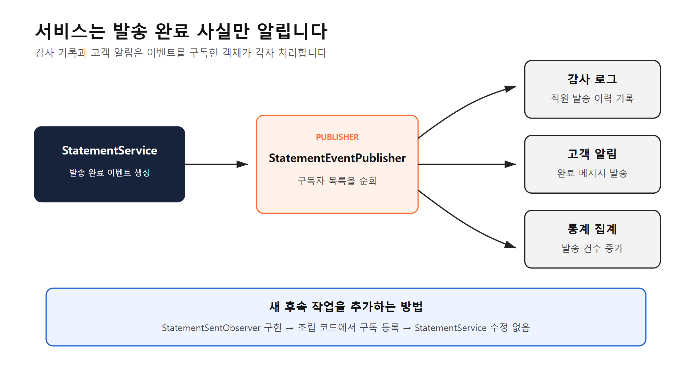

이벤트에는 후속 작업에 필요한 데이터를 담는다.

```java
class StatementSentEvent {
    String userId;
    String receiver;
    String document;

    StatementSentEvent(
            String userId,
            String receiver,
            String document
    ) {
        this.userId = userId;
        this.receiver = receiver;
        this.document = document;
    }
}

interface StatementSentObserver {
    void 발송완료(StatementSentEvent event);
}
```

발행자는 등록된 옵저버를 순서대로 호출한다.

```java
class StatementEventPublisher {
    private final List<StatementSentObserver> observers = new ArrayList<>();

    void 구독한다(StatementSentObserver observer) {
        observers.add(observer);
    }

    void 발행한다(StatementSentEvent event) {
        for (StatementSentObserver observer : observers) {
            observer.발송완료(event);
        }
    }
}
```

서비스는 발송 성공 사실만 발행한다.

```java
sender.발송한다(request.receiver, document);

publisher.발행한다(new StatementSentEvent(
        user.id,
        request.receiver,
        document
));
```

<!-- pagebreak -->

# STEP 9 — 옵저버를 추가해도 서비스는 바뀌지 않는다

감사 기록과 고객 알림은 같은 이벤트를 서로 다른 방식으로 처리한다.

```java
class AuditLogObserver implements StatementSentObserver {
    @Override
    public void 발송완료(StatementSentEvent event) {
        System.out.println(
                "[감사] " + event.userId + "의 발송 이력을 기록합니다."
        );
    }
}

class CustomerNotificationObserver implements StatementSentObserver {
    @Override
    public void 발송완료(StatementSentEvent event) {
        System.out.println(
                "[알림] " + event.receiver + "에게 완료를 안내합니다."
        );
    }
}
```

조립 코드에서 필요한 옵저버를 등록한다.

```java
StatementEventPublisher publisher = new StatementEventPublisher();
publisher.구독한다(new AuditLogObserver());
publisher.구독한다(new CustomerNotificationObserver());
publisher.구독한다(new DeliveryStatisticsObserver());
```

실행 결과는 발송 뒤에 이어진다.

```text
[발송] customer@bank.com에게 발송: PDF 거래명세서
[감사] staff01의 발송 이력을 기록합니다.
[알림] customer@bank.com에게 발송 완료를 안내합니다.
[통계] 거래명세서 발송 건수를 1 증가시킵니다.
```

이 예제의 발행자는 단순히 반복문으로 옵저버를 호출한다. 따라서 첫 번째 옵저버에서 예외가 발생하면 뒤의 옵저버가 실행되지 않는다. 운영 코드에서는 다음 중 하나를 결정해야 한다.

- 옵저버별 예외를 잡고 나머지를 계속 실행한다.
- 실패 이벤트를 재시도 큐에 저장한다.
- 트랜잭션 안에서 모두 성공하거나 모두 실패하게 한다.
- 감사 기록처럼 반드시 필요한 작업은 별도의 신뢰성 있는 이벤트 처리기로 보낸다.

<!-- pagebreak -->

# STEP 10 — 커맨드는 발송 요청을 객체로 저장한다

소스: [step10/App.java](../src/ex15/step10/App.java)

발송 요청을 받은 즉시 실행하지 않고 큐에 저장했다가 나중에 처리하려면 요청 자체를 객체로 만들어야 한다. 커맨드는 실행에 필요한 서비스, 사용자, 요청을 필드로 보관한다.

```java
interface Command {
    void execute();
}

class SendStatementCommand implements Command {
    private final StatementUseCase statementUseCase;
    private final User user;
    private final StatementRequest request;

    SendStatementCommand(
            StatementUseCase statementUseCase,
            User user,
            StatementRequest request
    ) {
        this.statementUseCase = statementUseCase;
        this.user = user;
        this.request = request;
    }

    @Override
    public void execute() {
        statementUseCase.명세서를발송한다(user, request);
    }
}
```

큐는 구체 명령을 몰라도 `execute()`만 호출한다.

```java
class CommandQueue {
    private final Queue<Command> commands = new ArrayDeque<>();

    void 추가한다(Command command) {
        commands.offer(command);
    }

    void 모두실행한다() {
        while (!commands.isEmpty()) {
            commands.poll().execute();
            System.out.println();
        }
    }
}
```

이 커맨드는 람다보다 분명한 실행 상태를 담을 수 있다. 예를 들어 `attemptCount`, `requestedAt`, `lastError`를 필드로 추가하면 재시도 정책과 실행 이력을 명령 객체 안에서 관리할 수 있다.

<!-- pagebreak -->

# STEP 10 — 퍼사드는 복잡한 조립과 큐 사용을 감춘다

클라이언트가 커맨드를 직접 만들고 큐에 넣는 과정을 모두 알 필요는 없다. 퍼사드는 예약과 실행이라는 두 개의 사용법만 제공한다.

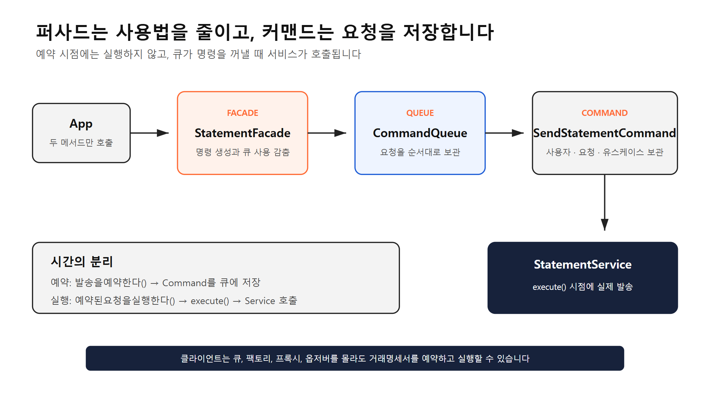

```java
class StatementFacade {
    private final StatementUseCase statementUseCase;
    private final CommandQueue commandQueue;

    StatementFacade(
            StatementUseCase statementUseCase,
            CommandQueue commandQueue
    ) {
        this.statementUseCase = statementUseCase;
        this.commandQueue = commandQueue;
    }

    void 발송을예약한다(User user, StatementRequest request) {
        commandQueue.추가한다(
                new SendStatementCommand(statementUseCase, user, request)
        );
        System.out.println("[예약] 발송 요청을 큐에 저장했습니다.");
    }

    void 예약된요청을실행한다() {
        commandQueue.모두실행한다();
    }
}
```

클라이언트 코드는 다음 두 메서드만 호출한다.

```java
facade.발송을예약한다(user, request);
facade.예약된요청을실행한다();
```

| 패턴 | 이 단계에서 해결하는 문제 |
|---|---|
| 커맨드 | 요청과 실행 시점을 분리하고 큐에 저장 |
| 퍼사드 | 명령 생성과 큐 사용을 단순한 메서드 뒤로 감춤 |

<!-- pagebreak -->

# 최종 조립 — 각 패턴을 한 시스템으로 연결한다

최종 단계에서는 앞에서 만든 객체를 애플리케이션 시작 지점에서 조립한다. 업무 서비스는 완성된 협력 객체를 주입받을 뿐이다.

```java
// 1. 검증 체인
RequestValidator validationChain = new LoginValidator();
validationChain
        .setNext(new RoleValidator())
        .setNext(new AccountValidator());

// 2. 실제 원장을 캐시 프록시로 감싼다.
TransactionSource transactionSource = new CachedTransactionSourceProxy(
        new CoreBankingTransactionSource()
);

// 3. 문서 생성기 등록
GeneratorFactory generatorFactory = new GeneratorFactory();
generatorFactory.등록한다(StatementFormat.PDF, PdfStatementGenerator::new);
generatorFactory.등록한다(StatementFormat.CSV, CsvStatementGenerator::new);
generatorFactory.등록한다(StatementFormat.HTML, HtmlStatementGenerator::new);
```

발송기와 옵저버도 같은 위치에서 등록한다.

```java
LegacyFaxClient faxClient = new LegacyFaxClient();

SenderFactory senderFactory = new SenderFactory();
senderFactory.등록한다(DeliveryChannel.EMAIL, EmailStatementSender::new);
senderFactory.등록한다(DeliveryChannel.SMS, SmsStatementSender::new);
senderFactory.등록한다(
        DeliveryChannel.FAX,
        () -> new FaxStatementSenderAdapter(faxClient)
);
senderFactory.등록한다(DeliveryChannel.PUSH, PushStatementSender::new);

StatementEventPublisher publisher = new StatementEventPublisher();
publisher.구독한다(new AuditLogObserver());
publisher.구독한다(new CustomerNotificationObserver());
```

<!-- pagebreak -->

# 최종 조립 — 핵심 서비스는 추상화만 전달받는다

`StatementService`의 생성자에는 구체 생성기나 구체 발송기가 없다.

```java
StatementUseCase statementService = new StatementService(
        validationChain,
        transactionSource,
        generatorFactory,
        senderFactory,
        publisher
);

StatementFacade facade = new StatementFacade(
        statementService,
        new CommandQueue()
);
```

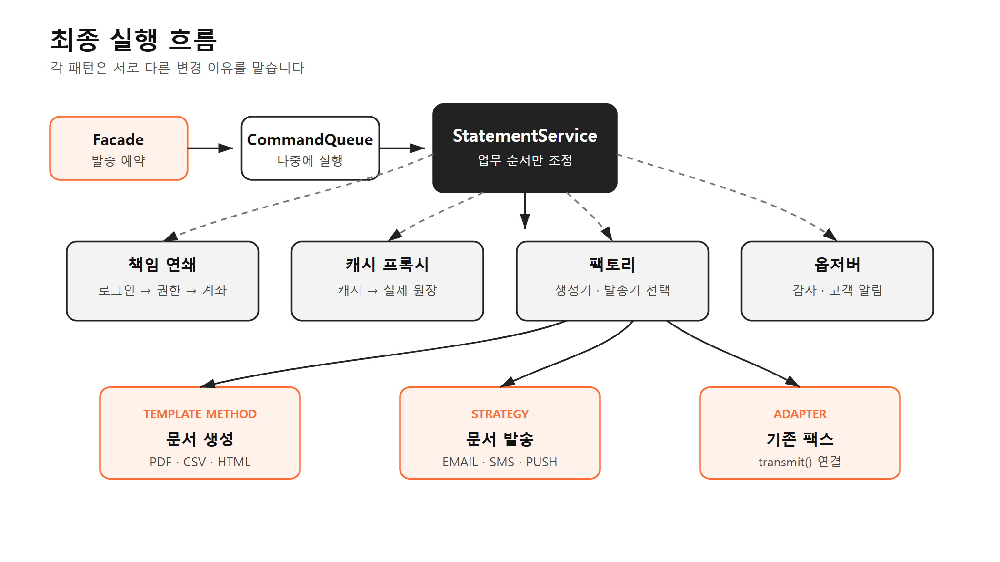

`StatementService.명세서를발송한다()`는 업무 순서만 조정한다.

```java
public void 명세서를발송한다(User user, StatementRequest request) {
    System.out.println("[시작] " + request.format + " / " + request.channel);

    if (!validator.검증한다(user, request)) {
        return;
    }

    String transactions = transactionSource.거래내역조회(
            request.accountNo,
            request.period
    );

    StatementGenerator generator = generatorFactory.생성한다(request.format);
    StatementSender sender = senderFactory.생성한다(request.channel);

    String document = generator.생성한다(transactions);
    sender.발송한다(request.receiver, document);
    publisher.발행한다(
            new StatementSentEvent(user.id, request.receiver, document)
    );
}
```

검증 방법, 원장 조회 정책, 문서 형식, 발송 채널, 후속 작업은 모두 바깥 객체로 이동했다.

<!-- pagebreak -->

# 최종 실행 — 세 요청에서 무엇을 확인해야 하는가

최종 예제는 같은 계좌와 기간으로 세 건을 예약한다.

```java
// 기본 기능
facade.발송을예약한다(user, new StatementRequest(
        "110-123-456789", "2026-08",
        StatementFormat.PDF, DeliveryChannel.EMAIL,
        "customer@bank.com"
));

// 새 기능
facade.발송을예약한다(user, new StatementRequest(
        "110-123-456789", "2026-08",
        StatementFormat.HTML, DeliveryChannel.PUSH,
        "customer-device-token"
));

// 기존 시스템 연결
facade.발송을예약한다(user, new StatementRequest(
        "110-123-456789", "2026-08",
        StatementFormat.CSV, DeliveryChannel.FAX,
        "051-000-0000"
));

facade.예약된요청을실행한다();
```

예약할 때는 아직 원장을 조회하거나 문서를 만들지 않는다.

```text
[예약] 거래명세서 발송 요청을 큐에 저장했습니다.
[예약] 거래명세서 발송 요청을 큐에 저장했습니다.
[예약] 거래명세서 발송 요청을 큐에 저장했습니다.
```

실행을 시작하면 첫 요청에서만 실제 원장을 조회한다.

```text
[시작] PDF / EMAIL
[검증] 로그인 확인
[검증] 직원 권한 확인
[검증] 계좌 접근 권한 확인
[캐시 MISS] 실제 원장 시스템을 조회합니다.
[원장 시스템] 110-123-456789 / 2026-08 거래내역 조회
[문서] 거래명세서 생성을 준비합니다.
[PDF] 은행 로고와 제목 작성
[PDF] 표로 작성: 입금 100,000원 / 출금 30,000원
[PDF] 안내 문구 작성
[이메일] customer@bank.com에게 발송: PDF 거래명세서
[감사] staff01의 발송 이력을 기록합니다.
[알림] customer@bank.com에게 발송 완료를 안내합니다.
```

<!-- pagebreak -->

# 최종 실행 — 확장 기능과 어댑터를 출력으로 확인한다

두 번째 요청은 같은 계좌와 기간이므로 캐시를 사용한다. HTML 생성기와 PUSH 발송기는 새 클래스로 추가되었다.

```text
[시작] HTML / PUSH
[검증] 로그인 확인
[검증] 직원 권한 확인
[검증] 계좌 접근 권한 확인
[캐시 HIT] 저장된 거래내역을 반환합니다.
[문서] 거래명세서 생성을 준비합니다.
[HTML] 제목 태그 작성
[HTML] 테이블로 작성: 입금 100,000원 / 출금 30,000원
[HTML] 닫는 태그 작성
[푸시] customer-device-token에게 앱 알림 발송: HTML 거래명세서
[감사] staff01의 발송 이력을 기록합니다.
[알림] customer-device-token에게 발송 완료를 안내합니다.
```

세 번째 요청도 캐시를 사용하고, 발송 단계에서 어댑터가 기존 팩스 API를 호출한다.

```text
[시작] CSV / FAX
[캐시 HIT] 저장된 거래내역을 반환합니다.
[CSV] 열 이름 작성
[CSV] 행으로 작성: 입금 100,000원 / 출금 30,000원
[CSV] 마지막 줄 확인
[기존 팩스] 051-000-0000로 전송: CSV 거래명세서
[감사] staff01의 발송 이력을 기록합니다.
[알림] 051-000-0000에게 발송 완료를 안내합니다.
```

이 출력에서 확인해야 하는 것은 패턴 이름이 아니라 다음 사실이다.

- 예약과 실행 시점이 분리되었다.
- 검증 실패 전에는 원장 조회가 실행되지 않는다.
- 동일 조회 조건은 캐시가 처리한다.
- 요청 값에 따라 문서 생성기와 발송기가 선택된다.
- 기존 팩스는 어댑터 뒤에서만 보인다.
- 발송 성공 뒤 옵저버들이 실행된다.

<!-- pagebreak -->

# 최종 UML — 변경 방향으로 읽는다

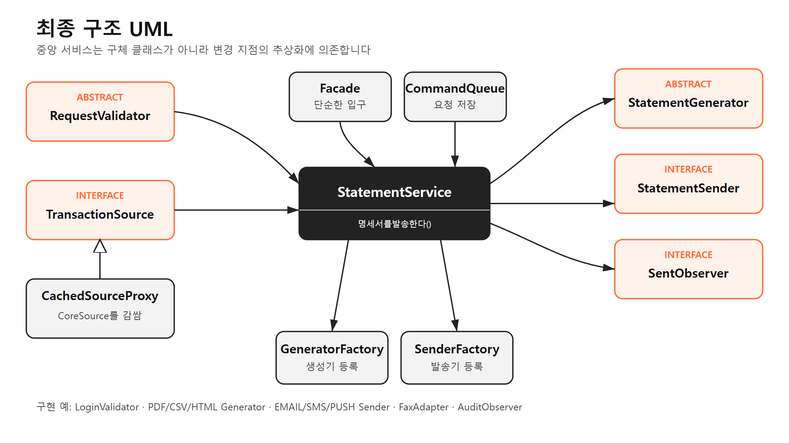

UML은 클래스 이름을 외우는 그림이 아니다. 새 요구사항이 어느 방향으로 확장되는지 확인하는 지도다.

| 새 요구사항 | 추가하거나 교체할 지점 | 수정하지 않을 중심 코드 |
|---|---|---|
| 야간 발송 제한 | `RequestValidator` 구현 | `StatementService` |
| 다른 원장 조회 정책 | `TransactionSource` 구현 또는 프록시 | `StatementService` |
| JSON 문서 | `StatementGenerator` 구현 | 기존 생성기와 서비스 |
| 카카오 발송 | `StatementSender` 구현 | 기존 발송기와 서비스 |
| 보안 관제 알림 | `StatementSentObserver` 구현 | 발송 흐름 |

핵심 서비스가 구체 클래스 대신 추상화와 팩토리에 의존하므로 변경은 각 확장 지점으로 이동한다. 클래스가 많아진 이유는 복잡성을 없앤 것이 아니라 **변경 이유별로 이름을 붙여 분리했기 때문**이다.

<!-- pagebreak -->

# OCP 실습 — JSON 문서와 KAKAO 발송을 추가한다

최종 과제는 `StatementService`를 수정하지 않고 두 기능을 추가하는 것이다.

JSON 생성기는 템플릿 메서드의 네 단계를 구현한다.

```java
class JsonStatementGenerator extends StatementGenerator {
    @Override
    protected void 머리말을작성한다() {
        System.out.println("[JSON] 객체 시작과 메타데이터 작성");
    }

    @Override
    protected void 거래내역을작성한다(String transactions) {
        System.out.println("[JSON] transactions 작성: " + transactions);
    }

    @Override
    protected void 꼬리말을작성한다() {
        System.out.println("[JSON] 객체 닫기");
    }

    @Override
    protected String 완성된문서() {
        return "JSON 거래명세서";
    }
}
```

카카오 발송은 공통 발송 인터페이스를 구현한다.

```java
class KakaoStatementSender implements StatementSender {
    @Override
    public void 발송한다(String receiver, String document) {
        System.out.println(
                "[카카오] " + receiver + "에게 발송: " + document
        );
    }
}
```

enum 값을 추가한 뒤 조립 코드에 생성 방법을 등록한다.

```java
generatorFactory.등록한다(
        StatementFormat.JSON,
        JsonStatementGenerator::new
);

senderFactory.등록한다(
        DeliveryChannel.KAKAO,
        KakaoStatementSender::new
);
```

<!-- pagebreak -->

# OCP 실습 — 야간 검증과 보안 관제 옵저버를 추가한다

실제 시간 계산 대신 생성자에서 전달받은 불리언 값으로 야간 여부를 표현한다.

```java
class NightTimeValidator extends RequestValidator {
    private final boolean night;

    NightTimeValidator(boolean night) {
        this.night = night;
    }

    @Override
    protected boolean 현재검증을통과한다(
            User user,
            StatementRequest request
    ) {
        if (night) {
            System.out.println("[중단] 야간에는 발송할 수 없습니다.");
            return false;
        }
        System.out.println("[검증] 발송 가능 시간 확인");
        return true;
    }
}
```

보안 관제는 발송 완료 이벤트를 구독한다.

```java
class SecurityMonitoringObserver implements StatementSentObserver {
    @Override
    public void 발송완료(StatementSentEvent event) {
        System.out.println(
                "[보안관제] " + event.userId + "의 발송을 알립니다."
        );
    }
}
```

새 객체는 조립 코드에서 연결한다.

```java
validationChain
        .setNext(new NightTimeValidator(false))
        .setNext(new RoleValidator())
        .setNext(new AccountValidator());

publisher.구독한다(new SecurityMonitoringObserver());
```

## 완료 기준

1. `JSON + KAKAO` 요청이 정상 발송된다.
2. 야간 검증이 실패하면 원장 조회 출력이 나타나지 않는다.
3. 정상 발송 뒤 보안 관제 출력이 나타난다.
4. 기존 `PDF + EMAIL`, `CSV + FAX` 결과가 그대로다.
5. `StatementService`의 변경 줄 수는 0이다.

<!-- pagebreak -->

# 패턴을 선택할 때는 변경 이유부터 찾는다

이 예제에 많은 패턴을 넣은 이유는 하나의 시스템에 패턴을 최대한 많이 사용하기 위해서가 아니다. 거래명세서 발송 시스템에서 반복해서 등장하는 서로 다른 변경 문제를 각각 분리하기 위해서다.

| 이런 문제가 반복될 때 | 검토할 구조 |
|---|---|
| 실행 방법을 교체하고 싶다 | 전략 |
| 전체 순서는 같고 일부 단계만 다르다 | 템플릿 메서드 |
| 타입에 따라 구현체를 선택한다 | 팩토리 |
| 기존 API의 호출 규격이 다르다 | 어댑터 |
| 검사를 순서대로 통과시킨다 | 책임 연쇄 |
| 같은 인터페이스로 접근 제어나 캐시를 끼운다 | 프록시 |
| 완료 사실에 여러 후속 작업이 반응한다 | 옵저버 |
| 요청을 저장하고 나중에 실행한다 | 커맨드 |
| 복잡한 하위 구조에 단순한 사용법을 제공한다 | 퍼사드 |

반대로 문서 형식이 PDF 하나이고 발송 채널도 이메일 하나로 고정되어 있다면 이 구조는 과하다. 패턴은 미래의 모든 요구사항을 미리 대비하는 장식이 아니다. 이미 자주 바뀌는 지점을 발견했을 때 그 변경을 안전하게 수용하기 위한 도구다.

## 마지막 점검 질문

- 서비스 메서드가 업무 순서만 보여 주는가?
- 새 기능을 추가할 때 기존 `if` 분기가 늘어나는가?
- 외부 API의 세부 호출이 어댑터 밖으로 새어 나오는가?
- 검증 실패 뒤 원장 조회와 발송이 실행되지 않는가?
- 발송 후 작업을 추가할 때 서비스가 바뀌는가?
- 캐시 키와 만료 정책이 도메인 요구사항에 맞는가?
- 커맨드가 실행에 필요한 요청 상태를 분명하게 보관하는가?

이 질문에 답할 수 있다면 패턴 이름을 외운 것이 아니라, 레거시 코드가 OCP를 만족하는 구조로 이동한 이유를 이해한 것이다.
